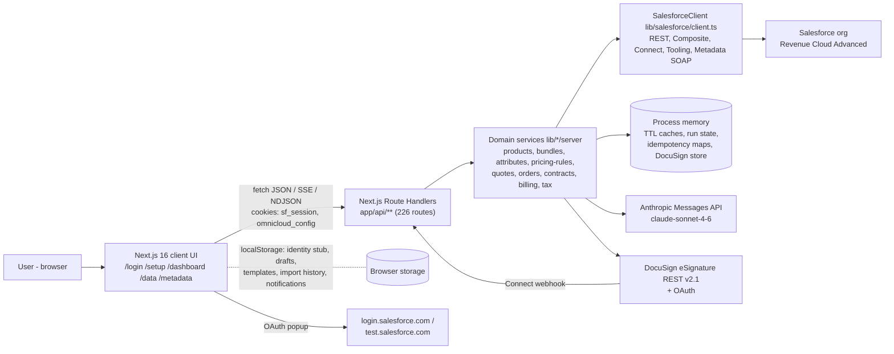
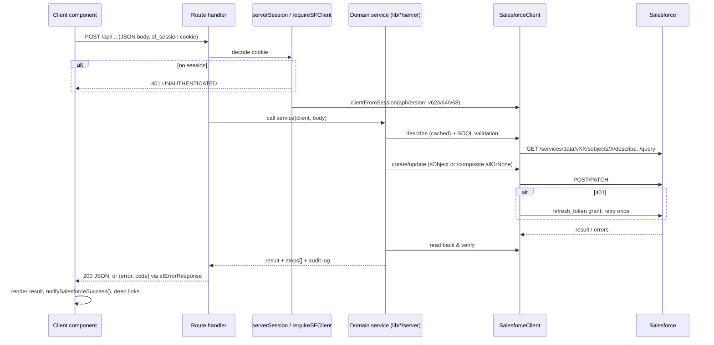
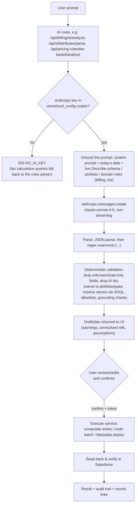
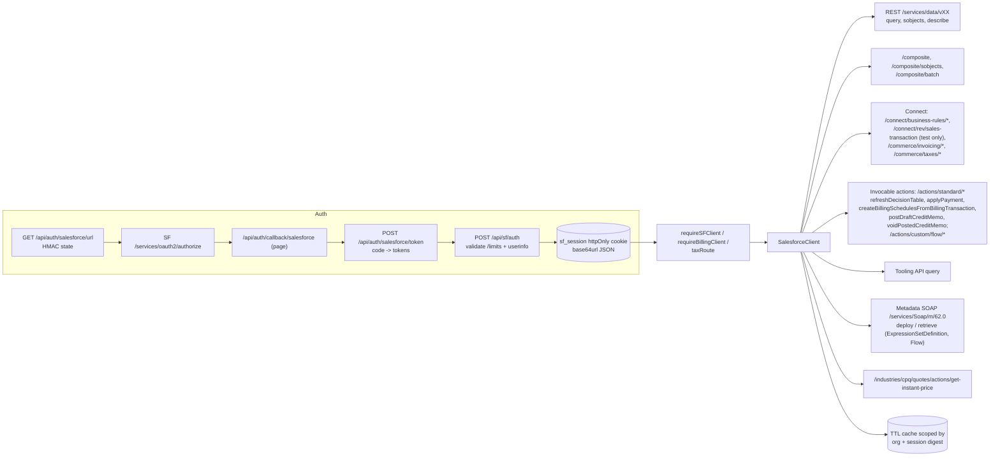
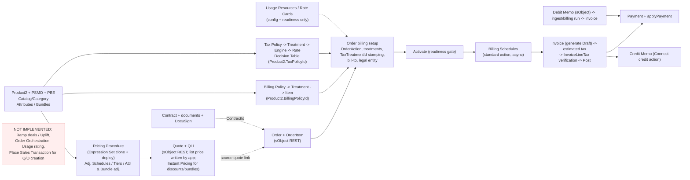

# OmniCloud RCA Accelerator: Application and Architecture Documentation

| | |
|---|---|
| **Document date** | 2026-11-02 |
| **Repository** | `OmniCloud-RCA-Accelerator-1-master` (package name `omnicloud-platform`, v0.1.0) |
| **Product names in the code** | "OmniVerse" (`app/layout.tsx` metadata), "Omnicloud AI Platform" (`HANDOFF.md`), with the "Omnion" mascot and the agents "Metadata Omnion" and "Data Omnion" |
| **Basis** | Static analysis of the source code, plus a type check, the unit test suite and ESLint, all run on 2026-11-02 (Section 12). No source or configuration files were changed. |
| **Audience** | Management, Salesforce teams, solution architects and developers |

> **How to read the status labels.** **Implemented** means the code calls live Salesforce APIs end to end. **Org-dependent** means it works only when the connected org has specific configuration, licences or permissions. **Partial** means part of the feature is built and part is missing. **Placeholder** means the UI exists but does nothing real (static numbers or a simulated save). **Not implemented** means nothing for it exists in the code. Anything that could not be verified from the code is marked *Unverified*.

---

## Contents

1. [Executive Summary](#1-executive-summary)
2. [Feature Inventory](#2-feature-inventory)
3. [Technical Architecture](#3-technical-architecture)
4. [Architecture Diagrams](#4-architecture-diagrams)
5. [Frontend Architecture](#5-frontend-architecture)
6. [Backend Architecture and API Inventory](#6-backend-architecture-and-api-inventory)
7. [Salesforce RCA Integration](#7-salesforce-rca-integration)
8. [AI Architecture](#8-ai-architecture)
9. [Data Flows and Business Workflows](#9-data-flows-and-business-workflows)
10. [Security and Configuration](#10-security-and-configuration)
11. [Deployment and Infrastructure](#11-deployment-and-infrastructure)
12. [Testing and Quality](#12-testing-and-quality)
13. [Codebase Inventory](#13-codebase-inventory)
14. [Implementation Status Matrix](#14-implementation-status-matrix)
15. [Architecture Recommendations and Roadmap](#15-architecture-recommendations-and-roadmap)
16. [Deliverables Index](#16-deliverables-index)

---

## 1. Executive Summary

### What it is
OmniCloud RCA Accelerator is a **Next.js 16 web application** that connects to a customer's **Salesforce Revenue Cloud Advanced (RCA)** org. Users describe what they want in plain English, and **Anthropic Claude** (`claude-sonnet-4-6`) turns the description into structured configuration. The application then validates that configuration against the live org, shows it for human review, and writes it to Salesforce through the Salesforce REST, Composite, Connect, Tooling and Metadata (SOAP) APIs.

It is an accelerator for consultants and Salesforce administrators. It does not replace Salesforce: every record it creates is a native Salesforce RCA record, and Salesforce stays the system of record.

### Why it was built
Setting up RCA by hand takes many dependent steps across dozens of setup objects, for example:
- Product2 → Selling Model Option → PricebookEntry → Catalog/Category
- Attribute Picklist → Definition → Classification → Product Attribute Definition
- Billing Policy → Treatment → Treatment Item
- Tax Policy → Treatment → Engine → Rate → Decision Table
- Pricing Procedure (Expression Set) → Decision Tables → Adjustment Schedules

These steps have to happen in a strict order, depend on how the org is set up, and fail with errors that are hard to diagnose. The codebase records many of these platform behaviours as executable rules. For example, an OrderItem's tax treatment is not inherited from Product2.TaxPolicyId, a Revenue Standard Tax engine returns 404 from the direct tax API, and every pricing procedure has to be cloned from a working "donor" procedure.

### Business problems it solves
| Problem | How the application addresses it |
|---|---|
| Setting up RCA catalogs, attributes and bundles by hand is slow | AI turns a prompt into a payload, then a multi-batch deploy creates the records (Products, Bundles, Attributes) |
| Pricing procedures are hard to build | Tier, volume, attribute and bundle pricing rules are generated as full Expression Set deployments, with decision table refresh, activation and verification |
| Billing and tax chains break silently | Readiness checks, policy-chain completion, tax remediation plans and an invoice-tax trace explain why tax or billing did not happen |
| The order-to-cash lifecycle is hard to test | Guided order billing setup: activate → billing schedules → invoice → post → payment, credit memo and debit memo |
| Org schemas differ | Field and object discovery is driven by Describe calls rather than hard-coded field names |
| Mistakes are expensive | Preview-then-confirm with approval tokens, duplicate gates, read-back verification and rollback where possible |

### Intended users
- OmniCloud consultants who implement RCA for clients. The login page has an "Omnicloud team member" identity step that is currently a stub (Section 10).
- Salesforce administrators and RCA functional consultants who configure catalogs, pricing, billing and tax.
- Solution architects who need to diagnose why pricing, billing or tax did not run as expected.

### How AI is used
- **Claude interprets intent; it never writes to Salesforce.** Every AI route returns a draft. Deterministic code then validates and normalizes it (dropping Ids the AI made up, and checking fields and picklist values against the org's Describe), resolves references by name using SOQL, and shows it to the user. A user action is required before any write.
- There are **22 AI-calling API routes** (23 counting the `/api/taxes/interpret` alias) across products, bundles, attributes, pricing rules, quotes, orders, contracts, billing, credit memos, debit memos, payments and tax (Section 8).
- **Each user brings their own Anthropic key.** It is entered in the Setup wizard and stored in an httpOnly cookie. By design there is no shared server key.

### How it differs from configuring Salesforce manually
1. One prompt replaces dozens of setup screens. For example, a single bundle prompt creates up to 9 batches of related records.
2. The application encodes platform rules that Salesforce applies at save time but does not expose through Describe (`lib/billing/server/rules.ts` R1–R9, `lib/tax/server/rateRules.ts`).
3. It produces diagnostics that native Salesforce does not provide: the tax trace from Invoice → Line → OrderItem → Treatment → Policy → Engine → Decision Table, pricing donor inspection, and quote parity diffs.
4. It keeps an audit trail of every REST call a run made, sanitized before display (`lib/salesforce/auditLog.ts`).

### Overall maturity (summary)
- **Strong, live and heavily hardened:** Pricing Rules, Tax, Billing, Products, Bundles, Attributes, Quotes, Orders and Contracts with DocuSign.
- **Not production-ready:** application login is a stub, all application state lives in process memory or browser localStorage, and there is no database, no middleware, no CI and no structured logging.
- **Not implemented:** Ramp Deals and Compound Uplift, Order Orchestration, usage ingestion and rating, the Place Sales Transaction API for quote and order creation, the Product Configurator API, and amendments and renewals.
- **Placeholders:** the whole Metadata Omnion page (static statistics, read-only live lists) and 13 of the CRM and Service objects on the Data page.

---

## 2. Feature Inventory

The application has two "agents" selected from `/dashboard` (`app/dashboard/page.tsx`):
- **Data Omnion** at `/data` (`app/data/page.tsx`, 2,515 lines). This is a single-route shell that hosts every working RCA module, organized into groups: *Core CRM*, *Revenue*, *Billing*, *Taxes*, *Service* and *Custom*.
- **Metadata Omnion** at `/metadata` (`app/metadata/page.tsx`). Largely a placeholder (see 2.17).

### 2.1 Product Management (Product Catalog, Product Configuration)
| Aspect | Detail |
|---|---|
| Purpose | Create, edit and inspect RCA products: Product2, selling model options, catalog and category placement, standard price, tax and billing policy |
| Workflow | `ProductsDashboard` → `ProductCreationChooser`, then one of: **Single** (prompt → `generate-payload` → Field/Value/Source review → `configuration/resolve` → `check-duplicate` → `save`), **Multiple** (prompt → `generate-payload-multi` → one review card per product → `import/validate` → `save` for each product), **Configuration** (a command such as "show configuration of X" or "assign Y Tax Policy" → `/command` preview → `/[id]/configuration` execute), or **Import** (CSV/XLSX wizard) |
| Frontend | `components/metadata/RCProductWorkspace.tsx`, `components/metadata/multi/MultiProductWorkspace.tsx`, `components/data/products/*`, `components/metadata/shared/FieldMappingTable.tsx` |
| Backend | `app/api/sf/products/**`, `lib/products/server/*` (`salesforceWrites.ts`, `pricebookEntry.ts`, `sellingModel.ts`, `revenueConfig.ts`, `productDetail.ts`, `duplicateCheck.ts`) |
| AI | `generate-payload` (single product, explicit-only extraction, 2,048 tokens) and `generate-payload-multi` (4,096 tokens). A deterministic regex parser (`lib/products/revenueConfig.ts` `mergePromptConfiguration`) fills in tax, billing and price book values the AI missed. `lib/products/productCommand.ts` is regex-based, not AI |
| Salesforce objects | Written: Product2, ProductCatalog, ProductCategory, ProductCategoryProduct, ProductSellingModelOption, PricebookEntry, and the Product2 fields TaxPolicyId and BillingPolicyId. Read: ProductSellingModel, Pricebook2, CurrencyType, UnitOfMeasure, ProductClassification, Tax* and Billing* chain objects |
| APIs | sObject REST (single-record writes) and SOQL. `save` pins v62.0; tax and billing configuration use the org's latest API version |
| Dependencies | Tax module (`discoverTaxMetadata`) and Billing (policy resolution) |
| Status | **Implemented** |
| Limitations | Attributes extracted by the AI are **not persisted** by the product save flow. Multi-product generation skips tax, billing and price book extraction. `Product2.Type` is forwarded only for "Bundle". There is no DELETE endpoint |

### 2.2 Bundle Management
| Aspect | Detail |
|---|---|
| Purpose | Build RCA bundles: a root bundle, nested bundles and component products |
| Workflow | `BundlesDashboard` → `BundleOrchestrationWorkspace` → prompt → `/api/bundles/parse` (AI) → edit tree and dependency rules → `/check-duplicate` → `/execute`, which deploys **9 batches** and streams progress over **Server-Sent Events**. Also: detail, components, dependencies, edit, duplicate and an import wizard |
| Frontend | `components/data/BundleOrchestrationWorkspace.tsx` (1,804 lines) and `components/data/bundles/*` |
| Backend | `app/api/bundles/**`, `lib/bundles/server/*` |
| AI | "RCA bundle architect" prompt, 4,096 tokens. The output is **not schema-validated**; the parsed JSON is returned to the UI as is |
| Salesforce objects | Product2 (Type=Bundle), ProductRelatedComponent, ProductRelationshipType, ProductAttribute, ProductCatalog, ProductCategory, ProductCategoryProduct, ProductSellingModelOption, PricebookEntry |
| Status | **Implemented** |
| Limitations | Dependency rules (REQUIRES, AUTO_ADD, DEPENDS_ON) are turned into component links only; **EXCLUDES is dropped**. No Salesforce rule objects are created. **ProductComponentGroup is never written.** Duplicating a bundle re-links the existing child products instead of copying them. `vercel.json` gives `/api/bundles/execute` a `maxDuration` of 300 s |

### 2.3 Attribute Management
| Aspect | Detail |
|---|---|
| Purpose | Define RCA attributes (picklists, definitions, classifications, product attribute definitions, defaults) |
| Workflow | `AttributesDashboard` → `RCAAttributeStudio` → prompt → `/api/sf/attributes/parse` (AI) → **product validation gate** (pick an existing product or create one) → 9 sequential `/execute-batch` calls (batches 0–8). Also: history, detail, edit and an import wizard |
| Frontend | `components/data/RCAAttributeStudio.tsx` (2,340 lines) and `components/data/attributes/*` |
| Backend | `app/api/sf/attributes/**`. `execute-batch/route.ts` alone is 1,827 lines. Plus `lib/attributes/server/*` |
| AI | "RCA business architect" prompt. Deterministic post-processing (`isExcludedAttribute`, `inferDataType`) filters out price, ERP, WMS and audit fields |
| Salesforce objects | AttributePicklist, AttributePicklistValue, AttributeDefinition, AttributeCategory, AttributeCategoryAttribute, ProductClassification, ProductClassificationAttr, ProductAttributeDefinition, Product2, catalog and category objects, ProductSellingModelOption, PricebookEntry. Runtime default objects are probed and used only if present |
| Status | **Implemented** and tolerant of different org schemas |
| Limitations | Batch 4 can fall back to *any* active ProductClassification, and batch 8 to *any* catalog or category, so records can be attached to unrelated parents. The route is a single large file |

### 2.4 Pricing Rules / Pricing Procedures
| Aspect | Detail |
|---|---|
| Purpose | Turn a plain-English pricing rule into native pricing records **plus a deployed and activated Pricing Procedure** (Expression Set) |
| Rule types | **Tier-based** (Slab; PriceAdjustmentSchedule + PriceAdjustmentTier; donor step `VolumeTierDiscount`), **Volume-based** (Range; donor step `VolumeDiscount`), **Attribute-based** (AttributeBasedAdjRule, AttributeAdjustmentCondition, AttributeBasedAdjustment; donor step `AttributeDiscount`), **Bundle-based** (BundleBasedAdjustment; donor step `BundleDiscount`) |
| Workflow | `/pricing-rules/create/[type]` or the Data shell → prompt → `/<type>/analyze` (AI extraction plus read-only org checks, returning a staged result) → user review → `/<type>/create`, which **streams NDJSON** progress through native records → decision table refresh → canvas build → **Metadata API deploy** → activate → verify |
| Frontend | `components/data/pricing-rules/*` and `app/pricing-rules/create/[type]/page.tsx` |
| Backend | `lib/pricing-rules/**` (141 files, about 43k lines, the largest module) |
| Key technique | **Donor cloning.** The pipeline retrieves a working Expression Set from the org (the default diagnostic donor is `Rev_Mgmt_Default_Pricing_Procedure2_V1`), scores candidates (`donorInspection.ts`), prunes and patches the XML (`canvasBuilder.ts`, `pricingCanvasPruning.ts`, `versionEnvelopeFields.ts`), zips it with JSZip, and deploys it through SOAP (`soapEnvelope.ts`, `deploy.ts`) |
| AI | Claude parses the prompt only (`parsePrompt.ts` in each type, 1,536 tokens). Product and attribute matching after that is deterministic (`fuzzyMatch.ts`) |
| Salesforce objects | Written: PriceAdjustmentSchedule, PriceAdjustmentTier, AttributeBasedAdjRule, AttributeAdjustmentCondition, AttributeBasedAdjustment, BundleBasedAdjustment, AttributePicklistValue, ProductAttributeDefinition, ExpressionSetVersion (activation), and Metadata types `ExpressionSetDefinition` and `Flow`. Read: ExpressionSet, DecisionTable, DecisionTableParameter, PricingRecipe, ContextMapping and others |
| Status | **Implemented and org-dependent.** The org needs a working donor procedure and the standard pricing decision tables. `POST /api/pricing-rules/create-procedure` is a **501 stub** for a generic form that none of the four types uses |
| Limitations | Run state lives in a `globalThis` map (`runBoundaryStore.ts`, labelled "TEMPORARY … NOT PRODUCTION-PERSISTENT"). XML is processed with regular expressions. The donor XML diagnostic route is temporary and gated by `DONOR_XML_DIAGNOSTIC=true`. Some UI copy is stale ("automation is coming in the next phase") |

### 2.5 Ramp Deals and Compound Uplift
**Not implemented.** Searches for `ramp`, `uplift`, `RampDeal` and `escalat` find no relevant code.

### 2.6 Quote Management
| Aspect | Detail |
|---|---|
| Purpose | Create RCA quotes with line items, bundles, attributes, selling models and billing frequency |
| Workflow | History, Create or Workspace. Create: an optional AI prompt (`/ai/parse-quote`, **header fields only**) pre-fills the form → `POST /api/quotes` → `LineItemsEditor` (catalog browser, then `BundleConfiguratorDialog` via `/products/configure`) → `POST /[id]/line-items`. Also an import wizard, a parity check against a quote created in the native Salesforce UI, and a client-side HAR viewer |
| Backend | `app/api/quotes/**`, `lib/quotes/**`. `lineItemCreate.ts` is about 1,400 lines and creates lines in dependency-ordered passes, rolling back on failure |
| Pricing | The app computes and writes the list price itself (`applyListPrice.ts`). It calls the Instant Pricing API (`/industries/cpq/quotes/actions/get-instant-price`) only for discounted or bundle lines. A code comment records that the instant pricing endpoint failed repeatedly, which is why the deterministic list price path was chosen |
| Salesforce objects | Quote, QuoteLineItem, QuoteLineRelationship or self-reference parent fields (detected at runtime), QuoteLineItemAttribute, and BillingPolicy/BillingTreatment (created through "billing policy recovery") |
| Status | **Implemented / Partial.** `ai/parse-line-items`, `products/match` and `[id]/reprice` exist but have **no UI caller** |
| Limitations | **Place Sales Transaction (`placeQuote`) is not used** for quote creation; records are created with plain sObject REST calls. No amendments or renewals |

### 2.7 Order Management
| Aspect | Detail |
|---|---|
| Purpose | Create orders with line items (same pattern as Quotes), plus bill-to contact and addresses, and a source quote or contract link |
| Backend | `app/api/orders/**`, `lib/orders/**` |
| Pricing | `lib/orders/pricing/reprice.ts` tries two **guessed** Connect endpoints (`/connect/pricing/order-calculate` and `/connect/pricing/orders/{id}/calculate`) and reports "unavailable" if both fail |
| Activation | `POST /api/orders/[id]/activate` goes through `activateOrderWithReadiness` (billing and tax readiness). The Orders UI does not call it; activation from the UI happens in the Billing order setup |
| Status | **Implemented / Partial** |
| Not present | **Order Orchestration** (no orchestration plans, fulfilment or decomposition code) and **Place Order** (Place Sales Transaction) |

### 2.8 Contracts and e-Signature (additional module)
| Aspect | Detail |
|---|---|
| Purpose | Create and activate Contracts, generate documents (PDF or DOCX) from templates with merge fields, and send them for e-signature through **DocuSign** |
| Documents | Four built-in HTML templates (MSA, NDA, SaaS Subscription, Software License). Users can upload DOCX templates (converted with `mammoth`). Output is rendered with `@react-pdf/renderer` or `docx` and stored as **ContentVersion** files on the Contract, using Salesforce file versioning |
| DocuSign | OAuth authorization code flow (demo or production), envelope create, status, recipients, audit events, recipient view (embedded signing), combined signed document, and a webhook receiver (HMAC checked only if a secret is configured). Signed dates are written back to the Contract only by the manual refresh route |
| Status | **Implemented, not production-ready.** DocuSign tokens, envelope tracking and signing links live in **server process memory**. Templates, drafts and signature state live in **browser localStorage** |

### 2.9 Revenue Cloud Billing
A metadata-driven console. `lib/billing/registry.ts` declares the modules; `lib/billing/server/discovery.ts` resolves them against the org's global Describe at runtime, and any module whose object is absent shows as "Not available in this org".

| Group | Modules (sObject) |
|---|---|
| Configuration | BillingPolicy, BillingTreatment, BillingTreatmentItem, `blng__BillingRule__c` (legacy package, only if installed), BillingMilestonePlan, BillingMilestonePlanItem, PaymentTerm, PaymentTermItem, LegalEntity |
| Usage (configuration only) | UsageResource, ProductUsageResource, UnitOfMeasure, UnitOfMeasureClass, UsageResourceBillingPolicy or UsageAggregationPolicy, RatingFrequencyPolicy, RateCard, RateCardEntry, RateAdjustmentByTier, PriceBookRateCard, ProductUsageGrant |
| Operations | BillingAccount, BillingScheduleGroup (read-only), BillingSchedule (read-only), Invoice (read-only), Payment |

Capabilities:
- **Generic CRUD**: Describe-driven forms, all-or-nothing `/composite` create and update, and validation through Describe plus platform rules R1–R9.
- **Billing policy chain completion**: create item → activate item → activate treatment → set default → activate policy. Each stage is confirmed separately and verified by reading back.
- **Product billing assignment**: replacing an existing policy returns 409 unless the request confirms the replacement.
- **Order billing setup** (`orderBilling.ts`, 1,153 lines):
  1. Create an OrderAction ("Add").
  2. Stamp the billing and tax treatment, PeriodBoundary, StartMonth and EndDate on each OrderItem.
  3. Set the legal entity, bill-to contact and addresses.
  4. Activate, with readiness checks.
  5. Create billing schedules (standard action).
  6. Generate a draft invoice.
  7. Post it, with tax verification.
  8. Every step is guarded by a state token.
- **Billing schedules and invoices**: generated by Salesforce, shown read-only.

**Status:** Implemented and org-dependent (Section 14).

### 2.10 Credit Memos
- Created asynchronously through `POST /commerce/invoicing/invoices/{id}/actions/credit`. Idempotency comes from a `[ref:key]` tag in the Description, and the app polls 8 times at 1.5-second intervals.
- Post, void and apply use standard actions (`postDraftCreditMemo` needs API 65+, `voidPostedCreditMemo` needs 67) and `/commerce/invoicing/credit-memos/{id}/actions/apply`.
- Tax strategies: Ignore, CopyFromInvoiceLine or Calculate.
- AI helper: `credit-memos/ai`.
- **Permission-dependent:** needs the "Credit Memo Operations User" permission set.

### 2.11 Debit Memos
- Use sObject REST, because the Connect API returns 404 for debit memos. A DebitMemo and its DebitMemoLines are created in one composite request. **API 65+ is required.**
- Lifecycle (`debitMemoLifecycle.ts`): configure → post → run billing (one-time Invoice Scheduler, after a confirmed preview token) or generate invoice (Invoice Ingestion API) → post invoice → create payment → settled.
- AI helper: `debit-memos/interpret`.
- **Permission-dependent:** "Billing Operations User" and "Data Pipelines Base User".

### 2.12 Payment and Settlement
- `recordPayment` creates a Payment and applies it with the standard action `applyPayment`, at invoice or line level.
- Idempotency uses `Payment.PaymentIntentGuid`. If the apply fails, compensation deletes or cancels the payment.
- `probeLineApplication` checks permission without changing data.
- AI helper: `payments/ai`.
- **Permission-dependent:** a permission set whose name or label contains "Payment".

### 2.13 Usage-Based Billing
**Configuration and readiness only.**
- You can create and edit usage resources, rate cards and related records through generic CRUD.
- Order billing checks for ProductUsageResource and TransactionUsageEntitlement.
- **Not implemented:** usage record ingestion, usage summaries, rating execution and usage invoicing. There are no references to UsageSummary, UsageRecord or TransactionJournal.

### 2.14 Tax Configuration
The Tax module has two UI surfaces and two API namespaces over one service layer, `lib/tax/server/*` (59 files, about 13.5k lines):
- **New:** `components/data/taxes/TaxesWorkspace.tsx`, calling `/api/taxes/*`.
- **Legacy:** `components/data/billing/tax/TaxWorkspace.tsx`, calling `/api/billing/tax/*`.
- Ten `/api/taxes/*` routes simply re-export the `/api/billing/tax/*` handlers.

| Sub-area | Implementation |
|---|---|
| Tax Policies, Tax Treatments, **Tax Treatment Items**, Tax Rates, Tax Engines, **Geography** (GeoCountry, GeoState) | Generic Describe-driven CRUD through `/api/taxes/objects/[module]`, restricted by `lib/taxes/routeGuard.ts` (`taxesOnly`). Tax requests are pinned to **API v68.0**, because TaxTreatmentItem and `TaxEngine.DecisionTableId` exist only on v68 |
| Decision tables (tax) | DecisionTable, DecisionTableParameter, DecisionTableDatasetLink and CalculationMatrix are view-only in CRUD. The dedicated routes **refresh** a stale table (with a token) and **create** a cloned `RevenueStandardTaxWithTaxCode` table for an engine (with `confirm: true`); they never modify the standard table |
| Whole-configuration setup | AI or manual `TaxConfigSpec` → `plan` (ordered steps plus a sha256 token) → `configure` (three composite phases: create, activate, map; rejected as STALE if the token no longer matches) → `verify` |
| Tax Assistant | interpret → preview (token) → execute. Supports create, update, assign, activate, deactivate, end-date, replace, delete and show. The AI prompt is grounded in live org metadata |
| Readiness and remediation | Org and product readiness, a calculation plan (READY_TO_CALCULATE, NEEDS_INPUT, NEEDS_CONFIGURATION or BLOCKED), and remediation executed one approval group at a time against an allowlist of fields that may be written |
| Calculation proof | `calculateSalesforceTax` creates an Order and OrderItem (with the treatment stamped), activates it, creates a billing schedule and invoice, and reads **InvoiceLineTax**. Each billable step needs explicit confirmation. Also: E2E runs, the legacy verification run (15 checks), and the invoice tax trace |
| Rate replacement | Creates a new rate and end-dates the old one in a single composite request, because TaxCode and the geography fields can only be set at creation |
| Tax Admin | Assigns the `RevenueLifecycleManagementBillingTaxAdmin` permission set to the **current user only** |
| Status | **Implemented and heavily org-dependent** (blockers are listed in Section 14) |

### 2.15 Decision Tables (cross-module)
- **Refresh** (`POST /actions/standard/refreshDecisionTable`) is used by Pricing Rules (attribute, list price and bundle lookup tables) and by Tax.
- **Evaluation preview** uses `POST /connect/business-rules/decision-table/{id}` (tax trace).
- **Creation** happens only for the tax TaxCode table.
- Pricing never creates decision tables; it only refreshes them.

### 2.16 Salesforce Connection and Setup
- `/login` uses a **stub** "Microsoft sign-in" that saves a placeholder identity to localStorage.
- `/setup` (`components/setup/SetupWizard.tsx`):
  1. Anthropic API key.
  2. Optional Salesforce Connected App client Id and secret.
  3. Connect to Salesforce, either through an OAuth popup (sandbox or production) or by pasting an access token and instance URL.
- Then `/dashboard`.

### 2.17 Placeholder and Limited Areas (verified)
| Area | Reality |
|---|---|
| **Metadata Omnion** (`/metadata`) | Sections for objects, fields, flows, Apex, LWC, permissions, integration and reports show **hard-coded statistics** (for example "Total 47"). Only a read-only "Live from Salesforce" list works, through `GET /api/sf/metadata` (Tooling or SOQL lists of ApexClass, ApexTrigger, LWC, Flows, ValidationRule, CustomObject, CustomField, PermissionSet, Report, Dashboard). Action cards such as "Create Object" and "Generate Trigger" have no backend |
| **Data Omnion CRM and Service objects** | Accounts, Contacts, Leads, Opportunities, Cases, Assets, Catalogs, Renewals, Work Orders, Entitlements, Knowledge, Queues and Custom Records use a generic `ObjectWorkspace` with static statistics. "Create" posts to `/api/sf/record/[sobject]` **only** for Account, Contact, Opportunity and Order; every other object **simulates** a save with a 1.2-second delay. The "AI command bar" only shows a toast ("AI command queued") and does nothing else |
| `components/data/RCAOrchestrationPlatform.tsx` (1,626 lines) | **Not imported anywhere** (dead code) |
| `POST /api/pricing-rules/create-procedure` | Always returns 501 |
| `POST /api/taxes/calculation` | Supports `validate` and `preview` only; any other action returns **410 `UNSUPPORTED_CALCULATION_PATH`** |

### 2.18 Shared Capabilities
- **Import toolkit** (`lib/import/*`, `components/import/*`): CSV and XLSX parsing (papaparse, xlsx), up to 8 MB and 1,000 rows, deterministic column mapping by alias, template download, read-only server validation, a sequential create queue run from the browser, and import history in localStorage. Used by Products, Bundles, Attributes, Quotes, Orders and Contracts.
- **Notifications** (`components/notifications/*`, `lib/notifications/*`): success and error toasts plus a bell with history in localStorage (`omni.notifications.v1`), with secrets scrubbed and deep links validated.
- **Prompt Guide** (`components/ai/PromptGuide.tsx`, `lib/ai/promptGuideConfig.ts`): example prompts and required fields for each AI entry point. It explicitly states which capabilities do not exist.
- **Duplicate detection** (`lib/duplicateDetection.ts` and the product and bundle `duplicateCheck.ts`): an advisory check in the UI, then the server checks again before writing and refuses if a duplicate exists.
- **Generic Salesforce passthrough**: `POST /api/sf/query` (any SOQL or Tooling query) and `/api/sf/record/[sobject]` (generic CRUD).

---

## 3. Technical Architecture

### 3.1 Technology stack
| Layer | Technology (version from `package.json`) |
|---|---|
| Framework (frontend and backend) | **Next.js 16.2.6**, App Router. `AGENTS.md` warns that this Next version has breaking changes compared with earlier versions |
| UI | **React 19.2.4**, Tailwind CSS v4 (`@tailwindcss/postcss`), framer-motion 12, lucide-react, next-themes, clsx, tailwind-merge, class-variance-authority |
| Language | **TypeScript 5** (strict), about 155k lines across `app`, `components` and `lib` |
| AI | `@anthropic-ai/sdk` ^0.98.0, model `claude-sonnet-4-6` |
| Documents | `@react-pdf/renderer`, `docx`, `mammoth`, `jszip` |
| Import | `papaparse`, `xlsx` |
| Runtime | Node.js (v24.15.0 used for this analysis). No `engines` field is pinned |
| Tests | Node's built-in `node:test` run through `tsx` (`npm test`) |
| Lint | ESLint 9 with `eslint-config-next` 16.2.6 (core-web-vitals and TypeScript) |

### 3.2 Architectural style
- **One Next.js application (a modular monolith).** The frontend is client components; the backend is Route Handlers (`app/api/**/route.ts`, **226 route files**). There is no separate backend service.
- **Three layers:**
  1. **Route handlers**: thin. They authenticate, parse the body, call a service, and map errors.
  2. **Domain services** in `lib/<domain>/server/*`: business logic, payload building, validation and verification.
  3. **Salesforce integration** in `lib/salesforce/*`: `SalesforceClient`, session handling, Describe cache, audit log.
- **Stateless server with no database.** Salesforce is the system of record. Application state lives in cookies, browser localStorage and process-memory maps.
- **No `middleware.ts` or `proxy.ts`.** Authentication is checked inside each route handler.

### 3.3 Entry points
| Entry | File |
|---|---|
| Root layout | `app/layout.tsx` (ThemeProvider, SalesforceSuccessProvider, Geist fonts) |
| `/` | `app/page.tsx` → redirects to `/login` |
| `/login` | `components/auth/LoginPage.tsx` |
| `/setup` | `components/setup/SetupWizard.tsx` |
| `/dashboard` | `app/dashboard/page.tsx` (choose an agent) |
| `/data` | `app/data/page.tsx` (all RCA modules) |
| `/metadata` | `app/metadata/page.tsx` |
| `/pricing-rules/create/[type]` | `app/pricing-rules/create/[type]/page.tsx` |
| `/contracts/sign-complete` | DocuSign return page |
| `/api/auth/callback/salesforce` | **A page** (`page.tsx`), not a route. It exchanges the code and uses `postMessage` to send the session to the window that opened it |

### 3.4 Routing
- **Frontend:** a few top-level routes. Inside `/data`, navigation is **state plus query string** (`lib/navigation/useUrlParams.ts`) with keys such as `module`, `qv`, `qid`, `ov`, `cv`, `pv`, `pdv`, `tv`, `tm` and `tid`, so views can be deep-linked.
- **Backend:** filesystem routes under `app/api`, organized by domain: `auth`, `sf`, `bundles`, `import`, `pricing-rules`, `quotes`, `orders`, `contracts`, `billing`, `taxes` and `config`. Dynamic segments include `[module]`, `[id]`, `[action]`, `[sobject]`, `[orderId]`, `[invoiceId]`, `[runId]`, `[envelopeId]` and `[token]`.

### 3.5 Cross-cutting concerns
| Concern | Implementation |
|---|---|
| Authentication (application) | **Stub.** A placeholder identity in localStorage (`lib/auth/identity.ts`, provider `"stub"`). Microsoft Entra is planned ("Phase B") |
| Authentication (Salesforce) | OAuth 2.0 web server flow with an HMAC-signed state, or a pasted access token. The session is stored in the **httpOnly cookie `sf_session`** |
| Authorization | Delegated entirely to Salesforce: each call runs as the connected user. Some services also check permission sets before writing (credit memo, payment, tax admin) |
| Session | Cookie lifetime 30 days. Access tokens refresh transparently on 401 (`SalesforceClient.tryRefresh`). Browser localStorage keeps a display copy with `accessToken: "[server-secured]"` |
| State management | React `useState` and context only (`SalesforceSuccessContext`); no Redux or Zustand. The URL query string holds navigation state |
| Persistence | None on the server. Browser localStorage holds drafts, templates, import history and notifications. Server memory holds caches, run state and DocuSign connections |
| Configuration | `omnicloud_config` httpOnly cookie (Anthropic key, Connected App credentials) plus environment variables (Section 10) |
| Errors | `sfErrorResponse` (`lib/salesforce/serverSession.ts`) gives a standard `{error, code}` shape: 401 → `TOKEN_EXPIRED` and the cookie is cleared; `REQUEST_LIMIT_EXCEEDED` → `SALESFORCE_API_LIMIT_EXCEEDED`, never retried automatically. Each domain has its own mappers (`lib/billing/server/errors.ts`, `lib/tax/server/route.ts`, `lib/products/ai/anthropicError.ts`) |
| Logging | `console.log`, `info` and `warn` only (for example `[sf-debug]`, `[tax-remediation]`). There is a per-request `debugLog` on `SalesforceClient`, sanitized into a user-visible audit trail. No structured or central logging |
| Caching | `lib/salesforce/cache.ts` TTL cache (10 minutes for Describe, 30 seconds for statistics) with **in-flight de-duplication**. Keys are scoped by instance URL plus a digest of the session, so data never leaks between orgs or users |
| Deployment | Designed for **Vercel** (`vercel.json`, `HANDOFF.md`). Runs locally with `next dev` |

---

## 4. Architecture Diagrams

### A. High-level system architecture


### B. Application request flow (typical write)


### C. AI-assisted configuration flow


### D. Salesforce integration architecture


### E. Revenue Cloud business process (as implemented)


---

## 5. Frontend Architecture

### 5.1 Layout and navigation
- **Root layout** (`app/layout.tsx`): Geist fonts, `next-themes` (dark by default, system theme disabled, toggled with the `class` attribute), and a global notification provider.
- **Routing gates** on each page (`useEffect`):
  - No identity → `/login`.
  - Setup not complete → `/setup`.
  - No session in localStorage → `/setup`.
- **Dashboard** (`/dashboard`): agent cards (Metadata Omnion, Data Omnion), the session user, the notification bell, theme and sign-out.
- **Data shell** (`/data`): a collapsible sidebar with groups (`DATA_GROUPS`) and objects, a header, and a content area.
  - Real modules render their own Module or Dashboard component inside `DashboardModuleFrame` (`components/data/dashboardShell.tsx`).
  - Placeholder objects render `ObjectWorkspace`.
- **Billing** (`BillingWorkspace.tsx`) and **Taxes** (`TaxesWorkspace.tsx`) have their own internal view routers, mirrored to the URL.

### 5.2 Component structure
| Directory | Responsibility |
|---|---|
| `components/auth` | Login page, environment selector, embedded login form, mascot |
| `components/setup` | Setup wizard (AI key, Connected App, Salesforce connection) |
| `components/data/<module>` | Dashboard, History list, Create flow, Workspace, Detail, Edit, Import wizard for each module |
| `components/data/billing`, `components/data/billing/tax` | Billing console and the legacy Tax workspace |
| `components/data/taxes` | New Taxes workspace, calculation, remediation, rate replacement, Salesforce lookup |
| `components/metadata` | Product single and multi-create workspaces, field mapping table |
| `components/import` | Reusable import wizard steps |
| `components/notifications` | Toasts, success cards, bell |
| `components/ai/PromptGuide.tsx` | Prompt help panel |
| `components/duplicates/DuplicateRecordModal.tsx` | Duplicate resolution |
| `components/ui`, `components/providers`, `components/brand` | Theme toggle, theme provider, branding |

The largest components are `RCAAttributeStudio.tsx` (2,340 lines), `BundleOrchestrationWorkspace.tsx` (1,804) and `app/data/page.tsx` (2,515).

### 5.3 Forms and validation
- Most RCA forms are **schema-driven**. The UI fetches `.../schema` (Describe-derived) and renders fields with type, picklist, reference and required metadata (for example `BillingFieldInput.tsx`, `BillingRecordForm.tsx`).
- Validation runs **on the server before writes** (`/validate` endpoints, `prepareAndValidate`, rules R1–R9), and the result is shown inline.
- Pure helpers shared by client and server cover some validation, for example `lib/orders/order/billingDetails.ts`.
- Reference fields use typeahead lookups (`ReferenceLookup.tsx`, `SalesforceLookup.tsx`, `ProductLookup.tsx`).

### 5.4 API communication
- Plain `fetch` to same-origin `/api/*` routes; cookies are sent automatically. There is no shared HTTP client, except `lib/quotes/client/apiClient.ts` for Quotes.
- **Streaming:**
  - **SSE** for `/api/bundles/execute`.
  - **NDJSON** for the pricing rule `/create` routes (read with `res.body.getReader()`).
  - Attribute batches are sequential POSTs driven by the client.
- Execution traces (`steps[]`) returned by the server are replayed in the UI (`lib/quotes/client/executionLog.ts`, `CreationAuditPanels.tsx`).

### 5.5 Loading, errors and interaction patterns
- Spinners and skeletons per panel, Omnion "mood" states, and framer-motion transitions.
- Errors are shown using the server's `error`, `code`, `possibleCause` and recommendation fields. `SALESFORCE_API_LIMIT_EXCEEDED` gets its own message.
- The common pattern is **preview → confirm**: approval tokens, explicit "confirm step" buttons, duplicate modals and stale-state (409) handling.
- Success notifications link to the record in Salesforce Lightning (`lib/salesforce/recordUrl.ts`).
- Drafts are autosaved to localStorage (quotes, orders, contracts).

### 5.6 Theme support
Dark (default) and light, through `next-themes` and `ThemeToggle.tsx`. Many components take an `isDark` prop and use inline styles, alongside Tailwind (`tailwind.config.ts`, `app/globals.css`).

---

## 6. Backend Architecture and API Inventory

### 6.1 Route handler conventions
- **Auth guards:**
  - `requireSFClient(req, apiVersion)` (`lib/salesforce/serverSession.ts`, defaults to v62.0)
  - `requireBillingClient` (v64.0, or v68.0 for tax)
  - `taxRoute(req, run, fallback, {mutates})` (`lib/tax/server/route.ts`)
  - Older `/api/sf/*` routes decode the cookie inline.
- **Shared mutation wrappers:** `paymentRoute` and `paymentMutation`, `creditMutation`, `orderBillingMutation`.
- **Response shapes:** `{ ...result }` on success; `{ error, code, possibleCause?, recommendation? }` on failure.

### 6.2 Service layer and payload generation
- **Describe-driven payloads.** Services resolve field names at runtime (`describeObjectCached`, `resolveField`, `firstExistingField`, `filterCreatable`, `nativeSchemaResolver.ts`) and never assume a schema.
- **Ordered multi-step pipelines:**
  - Bundle execute: 9 batches.
  - Attribute execute: 9 batches.
  - Product save: 10 steps.
  - Pricing rule create: 13 or more steps.
  - Order billing lifecycle.
  - Tax configure: three composite phases.
- **Write safety:** all-or-nothing `/composite` for Billing and Tax; `rollbackRecords` in quote and order line creation; read-back verification after writes; duplicate gates; plan and state tokens (sha256) to detect stale data.

### 6.3 API version management
| Constant | Value | Used for |
|---|---|---|
| `SF_API_VERSION` | v60.0 | Legacy `/api/sf/*` and the default client |
| `SF_API_VERSION_RCA` | v62.0 | Quotes, orders, contracts, products, bundles, pricing rules (`PRICING_RULES_API_VERSION`) |
| `SF_API_VERSION_BILLING` | v64.0 | Billing |
| `SF_API_VERSION_TAXES` | v68.0 | Tax, and billing routes for tax modules |
| `latestApiVersion()` | Discovered from `GET /services/data/` | Debit memos (65+), credit void (67), tax metadata, ingest |
| `PRICING_RULES_DEPLOY_API_VERSION` (env) | Default 62 | Rank and version injection in the Expression Set XML |
| Bundle test-quote | v64.0 | Flow-based quote pricing test |

### 6.4 Mock mode versus live mode
**There is no mock mode.** Every route calls the live connected org. The fakes exist only in unit tests: hand-written fake `SalesforceClient` objects and in-memory API interfaces such as `TaxRuntimeApi` and `DtApi`. "Simulated" behaviour appears only in the Data page placeholders (Section 2.17).

### 6.5 API inventory
All 226 route files are listed below, grouped by domain. Siblings with the same purpose are merged into one row. **SF** is the main Salesforce interaction. Status: **I** = Implemented, **P** = Partial or no UI caller, **S** = Stub, **D** = Diagnostic, **A** = Alias of another handler.

#### Auth, configuration and generic Salesforce access
| API Route | Method | Purpose | SF interaction | Status |
|---|---|---|---|---|
| `/api/auth/salesforce/url` | GET | Build the OAuth authorize URL with HMAC-signed state | None (builds URL) | I |
| `/api/auth/salesforce/token` | POST | Exchange the code for tokens and fetch identity | `/services/oauth2/token`, identity URL | I |
| `/api/sf/auth` | POST, DELETE | Validate the token (`/limits`, userinfo), set or clear the `sf_session` cookie | REST | I |
| `/api/sf/session` | GET, DELETE | Check the session (userinfo) or sign out | REST | I |
| `/api/config` | GET, POST, DELETE | Read status, save or clear the Anthropic key and Connected App credentials (cookie) | None | I |
| `/api/sf/query` | POST | Run any SOQL or Tooling query | Query, Tooling | I (generic) |
| `/api/sf/record/[sobject]` | GET, POST, PATCH, DELETE | Generic record CRUD | sObject REST | I (generic) |
| `/api/sf/metadata` | GET | List metadata (Apex, LWC, Flows and others) | Tooling, SOQL | I |
| `/api/import/parse` | POST | Parse CSV or XLSX | None | I |

#### Products (`/api/sf/products`)
| API Route | Method | Purpose | SF interaction | Status |
|---|---|---|---|---|
| `/` | GET | Latest 100 products | SOQL | I |
| `/stats` | GET | Product KPIs (30 s cache) | Aggregate SOQL | I |
| `/[id]` | GET, PATCH | Detail; update product, catalog, selling model option, price, tax and billing | sObject REST | I |
| `/[id]/configuration` | GET, POST | Read configuration; plan or execute tax and billing policy changes | SOQL, PATCH Product2 | I |
| `/command` | POST | Regex command parser (show or plan) | Read | I |
| `/configuration/resolve` | POST | Resolve tax and billing names to records | SOQL | I |
| `/options` | GET | Unit of measure options | SOQL, Describe | I |
| `/check-duplicate` | POST | Batch duplicate check | SOQL | I |
| `/save` | POST | Full product create pipeline | sObject REST, v62 | I |
| `/generate-payload` | POST | **AI**: one product from a prompt | None | I |
| `/generate-payload-multi` | POST | **AI**: several products from a prompt | None | I |
| `/import/parse`, `/import/validate` | POST | Import parse; read-only validation | SOQL | I |

#### Attributes (`/api/sf/attributes`)
| API Route | Method | Purpose | SF interaction | Status |
|---|---|---|---|---|
| `/parse` | POST | **AI**: attributes from a product description | None | I |
| `/execute-batch` | POST | Run batch 0–8 | Describe, sObject REST | I |
| `/[id]` | GET, PATCH | Detail; validated update with read-back | sObject REST | I |
| `/list`, `/stats` | GET | List and KPIs | SOQL | I |
| `/validate-product` | POST | Check the product exists | SOQL | I |
| `/import/validate` | POST | Import validation | SOQL | I |

#### Bundles (`/api/bundles`)
| API Route | Method | Purpose | SF interaction | Status |
|---|---|---|---|---|
| `/parse` | POST | **AI**: bundle tree | None | I |
| `/execute` | POST | 9-batch deploy (**SSE**, 300 s) | sObject REST | I |
| `/list`, `/stats`, `/pricebook` | GET | Bundles with components; KPIs; standard price book | SOQL | I |
| `/[id]` | GET, PATCH | Detail; edit fields and components | sObject REST | I |
| `/[id]/duplicate` | POST | Copy the root bundle and re-link its children | sObject REST | I |
| `/check-duplicate` | POST | Duplicate gate | SOQL | I |
| `/import/parse` | POST | File parse | None | I |

#### Pricing rules (`/api/pricing-rules`)
| API Route | Method | Purpose | SF interaction | Status |
|---|---|---|---|---|
| `/list`, `/stats` | GET | Expression sets list and KPIs | SOQL | I |
| `/product-search` | POST | Product typeahead | SOQL | I |
| `/create-procedure` | POST | Generic procedure | None | **S (501)** |
| `/tier-based/analyze`, `/volume-based/analyze`, `/attribute-based/analyze`, `/bundle-based/analyze` | POST | **AI** extraction plus read-only org analysis | SOQL, Describe | I |
| `/tier-based/create`, `/volume-based/create`, `/attribute-based/create`, `/bundle-based/create` | POST | Full pipeline (**NDJSON** stream) | REST, Composite, Tooling, Metadata SOAP, Connect, actions | I |
| `/tier-based/preview-canvas` | POST | Read-only canvas build | Metadata retrieve | P (no UI) |
| `/tier-based/verify-tier-schedule` | POST | Diagnose a tier schedule | SOQL | D |
| `/attribute-based/configure-attribute-default` | POST | Fix an attribute default value | sObject REST | I |
| `/attribute-based/donor-xml-diagnostic` | GET | Writes donor XML to `./diagnostics` (environment-gated) | Metadata retrieve | D (temporary) |
| `/bundle-based/test-quote` | POST | Price a test quote through a Flow (can create a quote through Place Sales Transaction) | `/connect/rev/sales-transaction/actions/place`, Metadata deploy (Flow), `/actions/custom/flow/*` | D |

#### Quotes (`/api/quotes`)
| API Route | Method | Purpose | SF interaction | Status |
|---|---|---|---|---|
| `/` | GET, POST | List the latest 50; create a Quote | SOQL, sObject | I |
| `/[id]` | GET | Detail | SOQL | I |
| `/[id]/line-items` | GET, POST | Read lines; create lines (passes, rollback, list price, optional Instant Pricing) | Composite, `/industries/cpq/.../get-instant-price` | I |
| `/[id]/reprice` | POST | Instant pricing | `get-instant-price` | P (no UI caller) |
| `/[id]/parity-check` | POST | Diff against a natively created quote (can reprice both) | SOQL, pricing | D |
| `/line-items` | DELETE | Delete lines | Composite delete | I |
| `/line-items/[id]` | PATCH | Edit a line | sObject | I |
| `/line-items/[id]/pricing-diagnostics` | GET | Line pricing diagnostics | SOQL | D |
| `/schema`, `/line-items/schema` | GET | Describe-driven schemas | Describe | I |
| `/products/search`, `/products/configure` | POST | Catalog search; bundle and attribute configuration | SOQL | I |
| `/products/match` | POST | Name to product matching | SOQL | P (no UI caller) |
| `/reference`, `/reference/search` | POST | Account, Price Book and Opportunity lookup | SOQL | I |
| `/billing-policy/options` | GET | Available billing policies | SOQL | I |
| `/billing-policy/assign`, `/billing-policy/recover` | POST | Assign or recover (may **create** BillingTreatment and BillingPolicy) | sObject | I |
| `/selling-model/diagnostics` | POST | Selling model diagnostics | SOQL | D |
| `/import/validate` | POST | Import validation | SOQL | I |
| `/stats` | GET | KPIs | Aggregate SOQL | I |
| `/ai/parse-quote` | POST | **AI**: quote header | None | I |
| `/ai/parse-line-items` | POST | **AI**: line items | None | P (no UI caller) |

#### Orders (`/api/orders`)
| API Route | Method | Purpose | SF interaction | Status |
|---|---|---|---|---|
| `/` | GET, POST | List; create an Order | SOQL, sObject | I |
| `/[id]` | GET, PATCH | Detail; update bill-to and addresses | sObject | I |
| `/[id]/line-items` | GET, POST | Read; create OrderItems | Composite | I |
| `/[id]/reprice` | POST | Tries guessed Connect pricing endpoints | `/connect/pricing/...` | P |
| `/[id]/activate` | POST | Activate (readiness), deactivate or cancel | sObject | P (not called from the Orders UI) |
| `/line-items` (DELETE), `/line-items/[id]` (PATCH), `/schema`, `/line-items/schema` (GET) | various | Line maintenance and schemas | sObject, Describe | I |
| `/products/search`, `/products/configure`, `/products/match` | POST | Catalog | SOQL | I |
| `/reference`, `/reference/search` | POST | Lookups | SOQL | I |
| `/billing-policy/recover`, `/import/validate` | POST | Recovery; import | sObject, SOQL | I |
| `/stats` | GET | KPIs | SOQL | I |
| `/ai/parse-order` | POST | **AI**: order header | None | I |

#### Contracts and DocuSign (`/api/contracts`)
| API Route | Method | Purpose | SF / external | Status |
|---|---|---|---|---|
| `/` | GET, POST | List; create a Contract | sObject | I |
| `/[id]` | GET, PATCH | Detail; edit (mutability check) | sObject | I |
| `/[id]/activate` | POST | Activate, expire or return to draft | PATCH Status | I |
| `/[id]/documents` | GET | List files | ContentDocumentLink, ContentVersion | I |
| `/[id]/documents/generate` | POST | Render PDF or DOCX and save as ContentVersion | sObject | I |
| `/[id]/documents/merge-values` | POST | Merge-field values | SOQL | I |
| `/[id]/documents/[contentVersionId]` | DELETE | Delete a document | ContentDocument | I |
| `/[id]/documents/[contentVersionId]/download` | GET | Download | VersionData | I |
| `/[id]/signature/send`, `/[id]/signature/send-test-link` | POST | Send an envelope; embedded signing test | DocuSign | I |
| `/contacts/preload`, `/contacts/search`, `/reference`, `/reference/search` | POST | Lookups | SOQL | I |
| `/templates/upload`, `/templates/preview/pdf` | POST | DOCX to HTML; PDF preview | None | I |
| `/schema`, `/stats` | GET | Schema; KPIs | Describe, SOQL | I |
| `/import/validate` | POST | Import | SOQL | I |
| `/ai/parse-contract` | POST | **AI**: contract header | None | I |
| `/docusign/connect`, `/docusign/callback` | GET | DocuSign OAuth | DocuSign OAuth | I |
| `/docusign/settings` | GET, POST | Settings (in memory) | None | I |
| `/docusign/disconnect`, `/docusign/refresh`, `/docusign/test` | POST | Connection management | DocuSign | I |
| `/docusign/webhook` | POST | DocuSign Connect events (HMAC optional) | DocuSign | I |
| `/docusign/sign/[token]` | GET | Redirect to the recipient view | DocuSign | I |
| `/docusign/envelopes/[envelopeId]/refresh`, `/retrieve-signed-document`, `/correct-recipient` | POST | Sync status and write signed dates; upload signed PDF; correct recipient | DocuSign, sObject | I |
| `/docusign/envelopes/[envelopeId]/diagnostics`, `/raw`, `/inspect-email-delivery` | GET | Envelope diagnostics | DocuSign | D |
| `/docusign/diagnostics/compare`, `/email-isolation-test`, `/production-parity-test`, `/test-send` | POST | Email delivery debugging | DocuSign | D |

#### Billing (`/api/billing`)
| API Route | Method | Purpose | SF interaction | Status |
|---|---|---|---|---|
| `/[module]` | GET, POST | List; create (composite, allOrNone) for any registry module | SOQL, `/composite` | I |
| `/[module]/schema` | GET | Describe-derived schema | Describe | I |
| `/[module]/validate`, `/[module]/[id]/validate` | POST | Dry-run create or update validation | Describe, SOQL | I |
| `/[module]/[id]` | GET, PATCH | Detail with children; update | SOQL, `/composite` | I |
| `/[module]/[id]/edit` | GET | Edit context and locks | SOQL | I |
| `/metadata` | GET | Org compatibility report | Describe | I |
| `/stats` | GET | KPIs (`/composite/batch`, 30 s) | Composite batch | I |
| `/reference/search` | POST | Generic lookup | SOQL | I |
| `/ai/analyze` | POST | **AI**: identify module, extract record or edit | Describe, SOQL (grounding) | I |
| `/policy-chain` | POST | Preview or confirm one chain stage | sObject | I |
| `/assignments`, `/assignments/check` | POST | Assign; dry-run assign a billing policy to a product | PATCH Product2 | I |
| `/assignments/product/[id]` | GET | A product's billing chain | SOQL | I |
| `/assignments/ai` | POST | **AI** assignment | SOQL | I |
| `/orders/context` | GET | Find the order from a schedule or invoice | SOQL | I |
| `/orders/[id]` | GET | Full billing state | SOQL | I |
| `/orders/[id]/setup` | POST | OrderAction and line treatments (composite) | `/composite` | I |
| `/orders/[id]/bill-to` | POST | Bill-to contact and addresses | PATCH Order | I |
| `/orders/[id]/activate` | POST | Activate with readiness checks | PATCH Order | I |
| `/orders/[id]/schedules` | POST | Create billing schedules | `/actions/standard/createBillingSchedulesFromBillingTransaction` | I |
| `/orders/[id]/invoices` | POST | Generate a draft invoice | `/commerce/invoicing/invoices/collection/actions/generate` | I |
| `/orders/[id]/invoices/[invoiceId]/post` | POST | Post (tax verified) | `/commerce/invoicing/invoices/collection/actions/post` | I |
| `/orders/[id]/ai` | POST | **AI**: next billing action | SOQL | I |
| `/credit-memos` | GET, POST | List; create (async) | `/commerce/invoicing/invoices/{id}/actions/credit` | I |
| `/credit-memos/[id]` | GET | Detail | SOQL | I |
| `/credit-memos/[id]/[action]` | POST | Post, apply or void | standard actions, `/credit-memos/{id}/actions/apply` | I |
| `/credit-memos/model`, `/credit-memos/status` | GET | Capability probe; async status | Probes, SOQL | I |
| `/credit-memos/validate`, `/credit-memos/ai` | POST | Preview; **AI** | SOQL | I |
| `/debit-memos` | GET, POST | List; create (composite) | `/composite` (API 65+) | I |
| `/debit-memos/[id]`, `/debit-memos/model` | GET | Detail; model | SOQL | I |
| `/debit-memos/[id]/lifecycle` | GET, POST | Read or advance the lifecycle | `/commerce/invoicing/invoice-schedulers`, `.../actions/ingest`, `.../post` | I |
| `/debit-memos/validate`, `/debit-memos/interpret` | POST | Validate; **AI** | SOQL | I |
| `/payments` | GET, POST | List; record and apply a payment | sObject, `/actions/standard/applyPayment` | I |
| `/payments/[id]` | GET | Detail | SOQL | I |
| `/payments/[id]/apply` | POST | Apply an existing payment | `applyPayment` | I |
| `/payments/invoices`, `/payments/invoices/[id]` | GET | Invoice search and detail | SOQL | I |
| `/payments/model`, `/payments/schema` | GET | Model and schema | Describe | I |
| `/payments/validate`, `/payments/ai` | POST | Preview; **AI** | SOQL | I |

#### Tax (`/api/billing/tax` and `/api/taxes`)
| API Route | Method | Purpose | SF interaction | Status |
|---|---|---|---|---|
| `/api/billing/tax` (alias `/api/taxes`) | GET | Tax dashboard | SOQL | I / A |
| `/api/billing/tax/metadata` (alias) | GET | Tax metadata, providers, named credentials | Describe, SOQL | I / A |
| `/api/billing/tax/interpret` (alias) | POST | **AI**: TaxConfigSpec | None | I / A |
| `/api/billing/tax/plan` (alias) | POST | Plan with token | SOQL | I / A |
| `/api/billing/tax/configure` (alias) | POST | Execute the plan (three composite phases) | `/composite` | I / A |
| `/api/billing/tax/verify` (alias) | POST | Verify (read-only) | SOQL | I / A |
| `/api/billing/tax/readiness` (alias) | GET | Org readiness | SOQL | I / A |
| `/api/billing/tax/products` (alias) | GET | Product search | SOQL | I / A |
| `/api/billing/tax/permissions/tax-admin` (alias) | GET, POST | Tax admin status; assign to self | PermissionSetAssignment | I / A |
| `/api/billing/tax/runs`, `/runs/[orderId]` (aliases) | GET, POST | Legacy verification runs (in memory) | Order to invoice chain | I / A |
| `/api/taxes/stats` | GET | Tax KPIs | Composite batch | I |
| `/api/taxes/lookup` | GET | Paged lookups | SOQL | I |
| `/api/taxes/objects/[module]` (+ `/schema`, `/validate`, `/[id]`, `/[id]/edit`, `/[id]/validate`) | GET, POST, PATCH | Tax object CRUD (generic billing handlers through `taxesOnly`) | `/composite` | I |
| `/api/taxes/assistant/interpret` | POST | **AI** assistant or calculation query (rules fallback) | Describe (grounding) | I |
| `/api/taxes/assistant/preview`, `/assistant/execute` | POST | Preview (token); execute (confirm and token) | `/composite` | I |
| `/api/taxes/readiness/product` | POST | Per-product readiness | SOQL | I |
| `/api/taxes/calculation` | POST | Validate or preview only; anything else returns 410 | SOQL | P |
| `/api/taxes/calculation/plan` | POST | Calculation plan and diagnostics | SOQL | I |
| `/api/taxes/calculation/remediate` | POST | Approval-gated remediation | sObject (allowlist) | I |
| `/api/taxes/calculation/salesforce`, `/[runId]` | POST, GET | Real Salesforce tax run (order to invoice to InvoiceLineTax) | Order, billing, invoicing APIs | I |
| `/api/taxes/billing/[orderId]` | GET, POST | Order tax readiness; generate a tax invoice | billing APIs | I |
| `/api/taxes/decision-table` | POST | Create a TaxCode decision table for an engine | sObject, refreshDecisionTable | I |
| `/api/taxes/decision-table/refresh` | POST | Token-gated refresh | `/actions/standard/refreshDecisionTable` | I |
| `/api/taxes/invoices/[invoiceId]/tax`, `/trace` | GET | Verify InvoiceLineTax; trace the chain (optional decision table preview) | SOQL, `/connect/business-rules/decision-table/{id}` | I |
| `/api/taxes/rates/[id]/replace` | POST | Preview or execute rate replacement | `/composite` | I |
| `/api/taxes/e2e` | POST | End-to-end validation run | Order, billing, invoicing APIs | I |

---

## 7. Salesforce RCA Integration

### 7.1 Authentication and tokens
- **OAuth 2.0 authorization code flow:**
  1. The setup wizard opens a popup to `{login|test}.salesforce.com/services/oauth2/authorize` with scope `api refresh_token openid profile email` and `prompt=login`. The `state` is `env|nonce|hmac16`, signed with `NEXTAUTH_SECRET`.
  2. The callback page posts the code to `/api/auth/salesforce/token`, which checks the state (constant-time comparison) and exchanges the code.
  3. The callback page sends the tokens to the opener with `postMessage` (same-origin check).
  4. The opener posts them to `/api/sf/auth`, which validates them (`/limits` plus userinfo) and sets the **`sf_session`** httpOnly cookie (`sameSite=lax`, `secure` in production, 30 days).
- **Access token mode:** the user pastes an instance URL and access token, which go to `/api/sf/auth`.
- **Refresh:** on a 401, `SalesforceClient.tryRefresh()` uses the refresh token with the Connected App credentials saved in the cookie, then retries once.
- **Connected App credentials:** taken from the user's config cookie first, then the `SALESFORCE_CLIENT_ID` and `SALESFORCE_CLIENT_SECRET` environment variables.
- **Instance URL:** taken from the token response or the user's input. It is normalized to https.

### 7.2 APIs used
| API | Where |
|---|---|
| REST Data: query, sObjects, describe, `/limits` | Everywhere |
| Composite: `/composite` (allOrNone), `/composite/sobjects`, `/composite/batch` | Billing, Tax, Quotes and Orders (lines), statistics |
| Tooling API query | Metadata lists, DecisionTable fallback lookups |
| Metadata API (SOAP) deploy and retrieve | Pricing procedures (`ExpressionSetDefinition`), Flow (bundle test-quote) |
| Connect Business Rules: `/connect/business-rules/expression-set/{id}`, `/connect/business-rules/decision-table/{id}` | Pricing version deactivation, tax decision table preview |
| Invocable actions: `/actions/standard/refreshDecisionTable`, `createBillingSchedulesFromBillingTransaction`, `applyPayment`, `postDraftCreditMemo`, `voidPostedCreditMemo`, `/actions/custom/flow/*` | Pricing, Billing, Tax |
| Commerce Invoicing: `/commerce/invoicing/invoices/collection/actions/{generate,post,ingest,calculate-estimated-tax}`, `/invoices/{id}/actions/credit`, `/credit-memos/{id}/actions/apply`, `/invoice-schedulers` | Billing, Tax |
| Commerce Tax: `/commerce/taxes/actions/calculate` | Present in code, but documented as **returning 404 for Revenue Standard Tax** and not used for authoritative results |
| CPQ Instant Pricing: `/industries/cpq/quotes/actions/get-instant-price` | Quotes (discounted and bundle lines) |
| Place Sales Transaction: `/connect/rev/sales-transaction/actions/place` | **Only** in the bundle pricing test-quote helper |
| Guessed endpoints: `/connect/pricing/order-calculate`, `/connect/pricing/orders/{id}/calculate` | Order reprice; existence *unverified* |

**SOQL safety.** Queries are built as strings with `soqlEscape()` (escapes backslashes and quotes) and regex checks on Salesforce Id formats. There are no bind variables.

### 7.3 Salesforce objects by category
| Category | Objects referenced in code |
|---|---|
| **Standard (Sales and Core)** | Account, Contact, Opportunity, Order, OrderItem, Contract, Pricebook2, PricebookEntry, Product2, CurrencyType, ContentVersion, ContentDocument, ContentDocumentLink, PermissionSet, PermissionSetAssignment, PermissionSetLicense, PermissionSetLicenseAssign, UserPermissionAccess, NamedCredential, Organization, FlowDefinitionView |
| **Revenue Cloud: Product Catalog Management** | ProductCatalog, ProductCategory, ProductCategoryProduct, ProductSellingModel, ProductSellingModelOption, ProductRelatedComponent, ProductRelationshipType, ProductComponentGroup (read only), ProductClassification, ProductClassificationAttr, ProductAttributeDefinition, ProductAttribute, AttributeDefinition, AttributePicklist, AttributePicklistValue, AttributeCategory, AttributeCategoryAttribute, ProductCategoryAttribute, AttributeSetItem, UnitOfMeasure, UnitOfMeasureClass |
| **Revenue Cloud: Pricing** | ExpressionSet, ExpressionSetVersion, ExpressionSetDefinition (metadata), DecisionTable, DecisionTableParameter, DecisionTableDatasetLink, CalculationMatrix, PriceAdjustmentSchedule, PriceAdjustmentTier, AttributeBasedAdjRule, AttributeAdjustmentCondition, AttributeBasedAdjustment, BundleBasedAdjustment, PricingRecipe, PricingRecipeTableMapping, ContextMapping |
| **Revenue Cloud: Transactions** | Quote, QuoteLineItem, QuoteLineRelationship, QuoteLineItemAttribute, OrderItemRelationship, OrderItemAttribute, OrderAction, AsyncOperationTracker, RevenueTransactionErrorLog |
| **Revenue Cloud: Billing** | BillingPolicy, BillingTreatment, BillingTreatmentItem, BillingMilestonePlan, BillingMilestonePlanItem, PaymentTerm, PaymentTermItem, LegalEntity, BillingAccount, BillingSchedule, BillingScheduleGroup, Invoice, InvoiceLine, InvoiceLineTax, CreditMemo, CreditMemoLine, CreditMemoInvApplication, CreditMemoLineInvoiceLine, DebitMemo, DebitMemoLine, Payment, PaymentLineInvoice, PaymentLineInvoiceLine, PaymentMethod, PaymentGateway, BillingBatchScheduler, InvoiceBatchRun, InvoiceBatchRunCriteria, BatchJob |
| **Revenue Cloud: Usage** | UsageResource, ProductUsageResource, UsageResourceBillingPolicy or UsageAggregationPolicy, RatingFrequencyPolicy, RateCard, RateCardEntry, RateAdjustmentByTier, PriceBookRateCard, ProductUsageGrant, TransactionUsageEntitlement |
| **Revenue Cloud: Tax** | TaxEngineProvider (read), TaxEngine, TaxPolicy, TaxTreatment, TaxTreatmentItem, TaxRate, GeoCountry, GeoState |
| **Custom or managed package** | `blng__BillingRule__c` (legacy Salesforce Billing, only if installed). **The application deploys no custom objects of its own** |

### 7.4 Deployment and activation workflows
- **Pricing procedures:** Metadata `deploy` (zip with `package.xml`, `rollbackOnError=true`), poll the status, then set `ExpressionSetVersion.IsActive = true` and deactivate other enabled versions.
- **Tier and volume schedules:** PriceAdjustmentSchedule is activated after its tiers exist.
- **Tax:** a three-phase configuration (create → activate → map), approved decision table refresh, and TaxCode decision table creation and activation.
- **Billing:** policy chain activation and order activation with a readiness gate.
- **Flow:** `RCA_Accelerator_Price_Quote_With_Procedure` is deployed or reused for the bundle pricing test.

### 7.5 Permission and org dependencies (from code)
- **Licences and features:** Revenue Cloud (Product Catalog Management, Pricing, Billing, Tax). Modules check object availability through Describe and degrade gracefully.
- **Permission sets checked or assigned:**
  - `RevenueLifecycleManagementBillingTaxAdmin` (self-assign)
  - "Credit Memo Operations User"
  - `RevenueLifecycleManagementBillingOperations`
  - "Data Pipelines Base User"
  - Any permission set with "Payment" in its name or label
- **API version floors:** 62 (pricing rank), 64 (billing), 65 (debit memo, credit post), 66 (ingest), 67 (credit void), 68 (TaxTreatmentItem, `TaxEngine.DecisionTableId`).
- **Org content prerequisites:**
  - A working donor pricing procedure and the standard pricing decision tables ("Tiered Adjustment Entries", "Volume Discount Entries", "Attribute Discount Entries", "Price Book Entries V2").
  - A standard price book.
  - A ProductRelationshipType "Bundle to Bundle Component Relationship".
  - Legal entities.
  - A tax engine with a decision table.
- **Documented platform limitations** (in comments and constants):
  - The StandardTax decision table lacks a TaxCode input and cannot be fixed through the API.
  - The direct tax API returns 404 for Revenue Standard Tax.
  - `TaxTreatment.LegalEntityId` is locked once the treatment leaves Draft, and is required for InvoiceLineTax.
  - `OrderItem.TaxTreatmentId` is not derived from the product, so the app stamps it.
  - Tax rates need `RateUsageType=RevCloud`, and only Net application basis is verified.
  - `InvoiceLine.ChargeAmountWithTax` is unreliable.
  - DebitMemo has no Connect API.

---

## 8. AI Architecture

### 8.1 Provider and integration
| Item | Detail |
|---|---|
| Provider | **Anthropic** (the only AI provider) |
| SDK | `@anthropic-ai/sdk` ^0.98.0, `messages.create`, **non-streaming**, no tool use and no retries |
| Model | `CLAUDE_MODEL = "claude-sonnet-4-6"` in `lib/config.ts`. Four older routes hard-code the same string (`bundles/parse`, `sf/attributes/parse`, `sf/products/generate-payload` and `-multi`) |
| Key handling | **Each user supplies their own key.** `POST /api/config` checks the `sk-ant-` prefix and stores the key in the `omnicloud_config` httpOnly cookie (`sameSite=strict`, 30 days). `resolveAnthropicKey(req)` reads **only** that cookie, and the design deliberately has **no environment variable fallback**; `lib/config.test.ts` enforces this. `GET /api/config` returns only booleans |
| Instantiation | `new Anthropic({ apiKey })` per request |

### 8.2 AI routes
| Route | Output | max_tokens | Grounding |
|---|---|---|---|
| `/api/sf/products/generate-payload` | Product JSON (explicit values only) | 2,048 | Few-shot; fixed list of selling models |
| `/api/sf/products/generate-payload-multi` | `{products: [...]}` | 4,096 | Same |
| `/api/bundles/parse` | Bundle tree and dependency rules | 4,096 | Schema in the prompt |
| `/api/sf/attributes/parse` | Attributes, classification, product | 4,096 | Eligibility rules |
| `/api/pricing-rules/{tier,volume,attribute,bundle}-based/analyze` | Rule extraction | 1,536 | Rule-type semantics (Slab compared with Range) |
| `/api/quotes/ai/parse-quote`, `/parse-line-items`, `/api/orders/ai/parse-order`, `/api/contracts/ai/parse-contract` | Header fields (and lines) | 1,024 | Today's date; "never invent an account" |
| `/api/billing/ai/analyze` | Module classification (300), then a record or edit draft | varies | **Live Describe** (fields, picklists, references, up to two levels of children), domain rules, today's date |
| `/api/billing/{assignments,credit-memos,payments}/ai` | Intent and references | 400 | Org lookups |
| `/api/billing/debit-memos/interpret` | Debit memo draft | 700 | Org lookups |
| `/api/billing/orders/[id]/ai` | One of a fixed list of actions | 500 | Order state |
| `/api/billing/tax/interpret` (alias `/api/taxes/interpret`) | `TaxConfigSpec` | 1,500 | Domain prompt |
| `/api/taxes/assistant/interpret` | Operations list (at most 15) or calculation query | 2,000 / 800 | **Live tax metadata brief** (writable fields, picklists, create-only flags), page context |

### 8.3 Output validation
1. **Parsing:** `JSON.parse`, falling back to a regex that extracts the outermost `{…}` (fenced code blocks are stripped first). A failure returns 502 or a staged "ai-parse-failed" result.
2. **Shape normalization:** for example `normalizeSpec`, `validateAndNormalize`, `buildProductIntent`, `toExtractedCombinations`, `normalizeAttributes` (allowlisted data and display types).
3. **Schema conformance (billing and tax):** unknown and read-only fields are dropped with warnings, and values are coerced to org types and picklists (`values.ts coerceFieldValue`).
4. **Id rejection:** Salesforce Ids produced by the AI are stripped (`specFromAi`, `idsRejected`). References are resolved **by name using SOQL**; ambiguous matches become `unresolved` with candidates.
5. **Grounding (tax calculation):** `groundValue` keeps a value only if it appears literally in the user's prompt.
6. **Deterministic reconciliation:** intent is classified with a verb regex, lifecycle changes the user did not ask for are dropped, and allowlists cap the number of operations.
7. **Known gap:** bundle AI output is **not schema-validated**; the raw JSON is returned to the UI.

### 8.4 How AI output is used, and whether AI touches Salesforce
**The AI never talks to Salesforce, and no AI route writes.** The application uses AI only to produce drafts, specifications or plans. Deterministic services then:
- validate them against the org,
- show them to the user for editing,
- execute them only after explicit confirmation, often with a sha256 approval token tied to the exact plan,
- verify them by reading back from Salesforce.

The tax remediation header states this directly: "nothing an AI says is executed".

### 8.5 Failure handling
- No key: **503 `NO_AI_KEY`**.
- Invalid key (`AuthenticationError`): 503.
- Other Anthropic `APIError`: 502.
- Anything else: 500 with a message.
- **Fallback:** only tax *calculation queries* fall back to the deterministic `parseTaxQuery`, and the response says which interpreter was used. Every other workflow has a **manual form or import path** in its place.

### 8.6 Security considerations
- The key never reaches client JavaScript: the cookie is httpOnly and `GET /api/config` returns booleans only. The audit log redacts any key named like `api_key` or `authorization`.
- **Prompt injection:** user text is sent to the model as is, but because outputs are drafts that are validated against the schema and need confirmation, the impact is limited. Grounding and Id stripping reduce the risk further.
- **Data sent to Anthropic:** user prompts and, for billing and tax, **org schema metadata** (field names, picklist values). Record data is generally not sent, but the order billing AI receives order state. *Unverified:* whether any route sends customer-identifying record values.
- The cookie is base64 encoded, **not encrypted** (Section 10).

---

## 9. Data Flows and Business Workflows

Each workflow below lists the user action, frontend processing, backend API, business logic, Salesforce interaction, records created, result and verification.

### 9.1 AI prompt → Salesforce configuration (Billing example)
1. **User:** types "Create a monthly billing policy in advance…" on a Billing create page.
2. **Frontend:** `BillingCreateWorkspace` posts the prompt and an optional `moduleKey`.
3. **API:** `POST /api/billing/ai/analyze`.
4. **Logic:** `identifyBillingModule` (if needed) → `analyzeBillingPrompt` with a live Describe system prompt → `normalizeRecord` → `prepareAndValidate` and rules R1–R9.
5. **Salesforce:** Describe and SOQL name resolution only.
6. **Records:** none yet.
7. **Result:** a draft with fields, children, links, warnings and unresolved references. The user edits it, then `POST /api/billing/[module]` sends one `/composite` allOrNone request (parent, inline children, opted-in inbound links such as `Product2.BillingPolicyId`).
8. **Verification:** the composite either fully succeeds or fully fails, and the detail view reads the record back.

### 9.2 Product creation → pricing configuration
1. **User:** prompt or form in `RCProductWorkspace`.
2. **Frontend:** `generate-payload` → review table → `configuration/resolve` → `check-duplicate`.
3. **API:** `POST /api/sf/products/save`.
4. **Logic:** duplicate gate (409) → price validation → tax and billing resolution (blockers return 422) → field resolution.
5. **Salesforce:** creates Product2; finds or creates Catalog and Category and links them; creates a ProductSellingModelOption for each matched selling model; creates the standard PricebookEntry (multi-currency aware); updates `Product2.TaxPolicyId` and `BillingPolicyId`.
6. **Result:** step log, record links and a configuration check.
7. **Verification:** configuration read back. The pricing *procedure* is a separate module (9.9).

### 9.3 Product → Quote → Order
1. **User:** creates a Quote (optional AI header), then adds lines through the catalog browser and bundle configurator.
2. **Frontend:** `CreateQuoteFlow`, `LineItemsEditor`, `BundleConfiguratorDialog`.
3. **API:** `POST /api/quotes`, `/products/configure`, `POST /api/quotes/[id]/line-items`.
4. **Logic:** resolves the selling model, billing frequency and treatment, attributes, and bundle expansion; required components are auto-selected; blocking reasons are computed (for example a missing billing policy, which triggers recovery).
5. **Salesforce:** Quote, then QuoteLineItems in passes ordered by dependency, then QuoteLineRelationship or parent fields and QuoteLineItemAttribute. The app writes the list price itself; Instant Pricing runs only for discounted or bundle lines.
6. **Order:** the same flow through `/api/orders` creates an Order linked to its source quote or contract. **Quote-to-order conversion through the Salesforce API is not implemented**; the order is created separately with a reference to the quote.
7. **Errors:** a failure rolls back the records created so far.

### 9.4 Order → Billing schedule → Invoice
1. **User:** opens an order in Billing order setup.
2. **API:** `GET /api/billing/orders/[id]` returns the full state and a state token.
3. **Setup:** `POST .../setup` sends one composite request: an OrderAction "Add", plus BillingTreatmentId, **TaxTreatmentId**, PeriodBoundary, StartMonth and EndDate on each OrderItem, and the order's LegalEntity.
4. **Bill-to:** `POST .../bill-to` sets the Contact (which must belong to the order's Account) and addresses.
5. **Activate:** `POST .../activate` runs `activateOrderWithReadiness`.
6. **Schedules:** `POST .../schedules` calls `createBillingSchedulesFromBillingTransaction` (asynchronous; refused if schedules already exist).
7. **Invoice:** `POST .../invoices` calls `invoices/collection/actions/generate` (Draft) and estimated tax.
8. **Post:** `POST .../invoices/{id}/post` is **blocked unless InvoiceLineTax verifies the tax** (`allowUnverifiedTax` overrides this).
9. **Errors:** a stale state token returns 409, `scheduleErrorCause` diagnoses failures, and tax blockers (`TAX_NOT_READY`, `TREATMENT_MISMATCH`) are reported.

### 9.5 Invoice → Payment → Settlement
1. **User:** chooses an invoice and amount, or uses the AI prompt.
2. **API:** `POST /api/billing/payments`.
3. **Logic:** `recordPayment` checks permissions, writes an idempotency GUID (`PaymentIntentGuid`), and allocates at line level where possible.
4. **Salesforce:** creates a Payment through sObject REST, then calls `/actions/standard/applyPayment` (invoice or line). If the apply fails, compensation deletes or cancels the Payment.
5. **Result:** payment, applications and the invoice's new balance.
6. **Settlement:** shown when `Invoice.Balance` is 0 or through SettlementStatus. Credit memos (asynchronous Connect action) and debit memos (sObject, then ingest or billing run, then invoice) feed the same balance.

### 9.6 Usage records → usage-based billing
**Not implemented beyond configuration.** You can create usage resources, rate cards, grants and policies through generic CRUD, and order billing readiness flags missing ProductUsageResource or TransactionUsageEntitlement. There is no usage ingestion, rating or usage invoicing.

### 9.7 Tax configuration → tax calculation → invoice line tax
1. **Configure:** AI or manual specification → `plan` (sha256 token) → `configure` (create TaxEngine, Policy, Treatments, Items and Rates; activate; map `Product2.TaxPolicyId`) → `verify`.
2. **Readiness and plan:** `/api/taxes/calculation/plan` identifies blockers, for example a missing `TaxTreatment.LegalEntityId`, a stale decision table, a StandardTax table without TaxCode, or a rate ProductCode mismatch.
3. **Remediate:** `/calculation/remediate` executes approval-gated groups (config, link, activation, refresh, permission) against an allowlist.
4. **Calculate:** `/calculation/salesforce` creates an Order and OrderItem with **TaxTreatmentId stamped**, activates it, creates billing schedules, generates the invoice, then waits up to 45 seconds (maximum 120) for **InvoiceLineTax**. Each step needs `confirm: "<step>"`.
5. **Trace:** `/invoices/[id]/trace` follows Invoice → Line → OrderItem → Treatment → Policy → Engine → Decision Table and classifies the result (for example `CONFIGURATION_MATCH`, `INVOICE_TIME_TAX_NOT_APPLIED`).
6. **Principle:** the application **never computes tax itself**. InvoiceLineTax from Salesforce is the only authoritative result.

### 9.8 Bundle configuration → bundle pricing
1. **Bundle build:** `/api/bundles/execute` writes 9 batches (Product2 leaves and bundles, ProductRelatedComponent, attributes, catalog, selling model option, PricebookEntry), streaming progress over SSE.
2. **Bundle pricing rule:** `/api/pricing-rules/bundle-based/analyze` (AI plus `discoverBundleStructure`) → `/create`:
   - BundleBasedAdjustment records and the bundle PriceAdjustmentSchedule,
   - refresh of the decision table whose source object is BundleBasedAdjustment (waits until complete),
   - cloned donor procedure with a `BundleDiscount` step,
   - Metadata deploy, activation, and re-retrieve to verify every binding.
3. **Test:** `/bundle-based/test-quote` can create a test quote through Place Sales Transaction and price it with the deployed procedure through a Flow.

### 9.9 Ramp deals → compound uplift
**Not implemented.** Tier and volume pricing (9.8 pattern, with `VolumeTierDiscount` and `VolumeDiscount` steps) are the closest existing capabilities.

---

## 10. Security and Configuration

### 10.1 Environment variables (names only; no values are recorded here)
| Variable | Required | Purpose |
|---|---|---|
| `SALESFORCE_CLIENT_ID`, `SALESFORCE_CLIENT_SECRET` | Optional (fallback) | Connected App credentials when the user has not entered them in Setup |
| `NEXTAUTH_SECRET` | **Required in production** | HMAC key for the OAuth `state`. **If it is unset, the code uses the hard-coded fallback `"omnicloud-dev-secret"`** |
| `NEXTAUTH_URL` | Recommended | Base URL for the OAuth `redirect_uri`. Otherwise derived from the `x-forwarded-host` and `x-forwarded-proto` headers |
| `DOCUSIGN_REDIRECT_URI` | Optional | DocuSign OAuth redirect |
| `NEXT_PUBLIC_APP_URL` | Optional | Public URL for DocuSign return and signing links |
| `PRICING_RULES_DEPLOY_API_VERSION` | Optional | Default 62 |
| `DONOR_XML_DIAGNOSTIC` | Optional | Enables a diagnostic route that **writes files to `./diagnostics`** |
| `NODE_ENV` | Standard | Sets the `secure` flag on cookies |
| `ANTHROPIC_API_KEY` | **Not used** | Referenced only in a test that proves it is ignored. `HANDOFF.md` lists it as required, which is **out of date** |

`.gitignore` excludes `.env*`, `*.csv`, `/diagnostics/` and `*.pem`.

### 10.2 Cookies and browser storage
| Store | Contents | Protection |
|---|---|---|
| `sf_session` cookie | Instance URL, **access token, refresh token, Connected App client Id and secret**, environment | httpOnly, `sameSite=lax`, `secure` in production, 30 days. **Base64url JSON, not encrypted or signed** |
| `omnicloud_config` cookie | **Anthropic API key**, Connected App client Id and secret | httpOnly, `sameSite=strict`, `secure` in production, 30 days. **Base64url JSON, not encrypted** |
| `docusign_oauth_state` cookie | DocuSign OAuth state | *Unverified* flags |
| localStorage | Identity stub, setup flag, session display data (the token replaced by `"[server-secured]"`), drafts, templates, signature state, import history, notifications | Readable by client JavaScript; contains no secrets by design |

### 10.3 Strengths
- Secrets are kept out of client JavaScript (httpOnly cookies). `GET /api/config` never returns values.
- The OAuth state is HMAC-signed with a constant-time comparison. `postMessage` checks the origin.
- Cache keys are scoped by org and a digest of the session, so data does not leak between users or orgs.
- The audit log redacts sensitive keys. Notification history scrubs secrets and re-validates deep links.
- Writes are approval-gated with tokens. Remediation writes are restricted to an allowlist.
- `REQUEST_LIMIT_EXCEEDED` is never retried automatically, which protects org API limits.
- State-changing routes use POST, PATCH or DELETE with JSON bodies, and `sameSite=lax` blocks cookies on cross-site POSTs and fetches.

### 10.4 Risks and gaps
| # | Risk | Severity |
|---|---|---|
| 1 | **Application login is a stub.** Anyone who can reach the app can "sign in"; the real protection is the Salesforce session and the Anthropic key | High (if hosted publicly) |
| 2 | **Cookies are not encrypted.** Tokens, refresh token, client secret and Anthropic key sit in plain base64. They are httpOnly, but anyone with access to the browser profile, a proxy log or a TLS-terminating intermediary can read them | High |
| 3 | `NEXTAUTH_SECRET` falls back to a **hard-coded development secret** | High in production if the variable is unset |
| 4 | OAuth tokens **pass through browser JavaScript** briefly (token route → callback page → `postMessage` → `/api/sf/auth`) instead of being set server-side in the callback | Medium |
| 5 | Generic passthroughs (`/api/sf/query` for any SOQL or Tooling query; `/api/sf/record/[sobject]` for any CRUD) act with the user's full Salesforce permissions | Medium (no privilege escalation, but a large attack surface if XSS occurs) |
| 6 | DocuSign OAuth tokens and secret are kept **unencrypted in server memory**, keyed by instance URL, so **users of the same org share one connection** | Medium |
| 7 | The DocuSign webhook accepts **unsigned events** when no secret is configured. It only triggers a re-pull of the envelope status, so impact is limited | Low to medium |
| 8 | SOQL is built with string escaping, not bind variables. The escaping and Id regex checks are consistent but this is the only defence | Low to medium |
| 9 | There is **no rate limiting, no CSRF token** (relies on `sameSite`), and no security headers or CSP configuration (`next.config.ts` is empty) | Medium |
| 10 | No CORS configuration (same-origin default), which is appropriate | Info |
| 11 | The `x-forwarded-host` fallback for the redirect URI can be spoofed if `NEXTAUTH_URL` is unset behind an untrusted proxy | Low |
| 12 | Prompts and org schema metadata are sent to Anthropic. A data-processing review may be needed for regulated clients | Info |

### 10.5 Input validation and permissions
- Request bodies are validated per route (required fields, Id regex, picklist coercion). Server validation endpoints run before writes. Import is capped at 8 MB and 1,000 rows. Billing AI prompts are capped at 4,000 characters.
- Permission checks rely on Salesforce enforcing FLS and CRUD for the session user, plus explicit permission set checks for credit memos, payments, debit memo billing runs and Tax Admin. Self-assignment applies to the **current user only**.

---

## 11. Deployment and Infrastructure

### 11.1 Local development
| Item | Detail |
|---|---|
| Required software | Node.js (≥ 20 recommended; `@types/node` ^20; Node 24 used for this analysis), npm |
| Install | `npm install` |
| Dev server | `npm run dev` (`next dev`) on **http://localhost:3000** (Next.js default; no custom port configured) |
| Build / start | `npm run build`, then `npm start` |
| Quality | `npm run typecheck` (`tsc --noEmit`), `npm run lint` (ESLint), `npm test` (`npx --yes tsx --test "lib/**/*.test.ts" "app/**/*.test.ts" "components/**/*.test.ts"`; downloads `tsx` on first run) |
| Configuration | `.env.local` with the variables in 10.1. Each user enters the Anthropic key and optionally the Connected App credentials in `/setup` |
| Salesforce Connected App | Callback URL `{base}/api/auth/callback/salesforce`; scopes `api refresh_token openid profile email`; authorization code grant. Works with sandbox (`test.salesforce.com`) and production (`login.salesforce.com`) |
| `.sf/` folder | Salesforce CLI local metadata cache (`.sf/orgs/<orgId>/metadata-catalog`). The application does not use it at runtime |

### 11.2 Hosting architecture
- **Target is Vercel.** `vercel.json` sets `maxDuration: 300` for `/api/bundles/execute`. `HANDOFF.md` describes deploying to a subdomain such as `rca.omnicloudconsulting.com`. That deployment checklist is **not complete** (secrets, Vercel project, Connected App redirect and end-to-end test are all unchecked).
- All API routes are dynamic serverless functions. There is no database, queue or object storage.
- **External dependencies:** the Salesforce org (with RCA licences), the Anthropic API, and DocuSign (optional).

### 11.3 Production considerations
1. **Serverless and multi-instance state is lost.** All `globalThis` maps (pricing run boundaries, tax verification runs, remediation idempotency, billing locks and caches, the DocuSign connection, envelope and signing link stores) are per instance and temporary. On Vercel these will **not** survive across invocations or cold starts. DocuSign and long-running multi-step runs are the most affected.
2. **Function duration.** Pricing rule creation (Metadata deploy plus polling), credit memo polling (up to about 12 seconds), debit memo billing runs (up to 10 × 5 seconds), tax runs (InvoiceLineTax wait up to 120 seconds) and attribute batches can exceed default limits. Only `bundles/execute` has a raised `maxDuration`.
3. **Diagnostics route.** `donor-xml-diagnostic` writes to the local filesystem; keep it disabled in production.
4. Set `NEXTAUTH_SECRET` and `NEXTAUTH_URL`, and register every redirect URI (production, preview, localhost) on the Connected App.
5. The application is designed for **both** local use and cloud deployment, but several features (anything stored in memory) are only reliable on a **single long-lived Node process**, such as `next start` on one VM or container.

---

## 12. Testing and Quality

### 12.1 Results of runs on 2026-11-02 (no files modified)
| Check | Command | Result |
|---|---|---|
| Unit tests | `npm test` | **982 tests, 982 passed, 0 failed** (about 13 s) |
| Type check | `npx tsc --noEmit --incremental false` | **0 errors in source.** 2 syntax errors in the generated `.next/dev/types/routes.d.ts` and `.next/dev/types/validator.ts`, which are stale or truncated dev-server artifacts. Regenerate with `next dev` or `next build`, or delete `.next/` |
| Lint | `npx eslint .` | **96 problems (82 errors, 14 warnings)**: `react/no-unescaped-entities` 28, `react-hooks/set-state-in-effect` 24, `react-hooks/refs` 24, `react-hooks/exhaustive-deps` 7, `@typescript-eslint/no-unused-vars` 5, others 8. These are mostly React 19 hook-rule and style findings, not functional failures |
| Build | `npm run build` | **Not run in this analysis.** `HANDOFF.md` records an earlier successful build, from when the app had 14 routes |

### 12.2 Test structure
- **91 test files** (about 18k lines), using `node:test` and `node:assert/strict`. There is no Jest or Vitest.
- Distribution: about 63 in `lib/pricing-rules` (canvas, XML, donor scoring, combinations, version and rank, ID validation, uniqueness, capacity preflight); about 20 in `lib/tax`; 4 in `lib/billing`; plus products, orders, notifications, configuration and cache-scope tests.
- **Mocking approach:** hand-written fake `SalesforceClient` objects (`as unknown as SalesforceClient`) and in-memory API interfaces (`TaxRuntimeApi`, `DtApi`, `TraceApi`). There is no `fetch` mocking and no HTTP-level tests.

### 12.3 Gaps
| Gap | Detail |
|---|---|
| Route and API tests | None. Route handlers are not exercised |
| AI tests | Anthropic calls are not tested; parsing and normalization helpers are only partly tested |
| Live Salesforce tests | None automated. Live verification is built into the product (read-back, tax runs, E2E routes), and code comments refer to manual live-org fixes |
| UI tests | None (no React Testing Library or Playwright). One pure helper test exists in `components/` |
| Coverage | Not measured (no coverage tool configured) |
| CI | No CI configuration found in the repository (no `.github/`) |
| Under-tested modules | Quotes (0 tests), Contracts and DocuSign (0), Bundles (0), Attributes (0), Products (1 file) |

### 12.4 Technical debt
- **Very large files:** `app/data/page.tsx` (2,515 lines), `RCAAttributeStudio.tsx` (2,340), `canvasBuilder.ts` (about 2,500), `sf/attributes/execute-batch/route.ts` (1,827), `BundleOrchestrationWorkspace.tsx` (1,804), `lineItemCreate.ts` (about 1,400), `orderBilling.ts` (1,153).
- **Duplicate surfaces:** two Tax UIs and two Tax API namespaces; parallel Quote and Order code (two `BundleConfiguratorDialog`, `ProductCatalogBrowser` and `LineItemsEditor` components).
- **Dead or unused code:** `RCAOrchestrationPlatform.tsx`; routes with no UI caller (`quotes/ai/parse-line-items`, `quotes|orders/[id]/reprice`, `products/match`, `tier-based/preview-canvas`).
- **Stale comments and copy:** "never creates decision tables" (tax), "8-batch" (attributes), and the pricing UI text "coming in the next phase".
- **Temporary code in production paths:** `§TEMPORARY` diagnostics, the donor XML diagnostic, and the DocuSign diagnostics routes.
- **Inconsistent API version pinning** (v60, v62, v64, v68 and discovered latest) and three routes that hard-code the model name.
- **Outdated documentation:** `README.md` is the create-next-app template, and `HANDOFF.md` describes 14 routes and an `ANTHROPIC_API_KEY` environment variable that no longer apply.

---

## 13. Codebase Inventory

### 13.1 Directory structure (excluding `node_modules`, `.next`)
```
/
├─ AGENTS.md, CLAUDE.md        AI-assistant instructions (Next 16 warning)
├─ HANDOFF.md                  Deployment working notes (partly outdated)
├─ README.md                   create-next-app boilerplate
├─ package.json, package-lock.json, tsconfig.json, next.config.ts (empty),
│  eslint.config.mjs, postcss.config.mjs, tailwind.config.ts, vercel.json
├─ .sf/                        Salesforce CLI local metadata cache (not runtime)
├─ public/                     Logos, Omnion mascot images, partner badge
├─ app/                        Next.js App Router (≈236 files, 19.7k lines)
│  ├─ layout.tsx, page.tsx, globals.css, icon.png
│  ├─ login/ setup/ dashboard/ data/ metadata/   Pages
│  ├─ pricing-rules/create/[type]/               Pricing rule page
│  ├─ contracts/sign-complete/                   DocuSign return page
│  └─ api/                                       226 route handlers
│     ├─ auth/ (salesforce url/token, callback page)
│     ├─ config/  import/  sf/ (auth, session, query, record, metadata, products, attributes)
│     ├─ bundles/  pricing-rules/  quotes/  orders/  contracts/
│     ├─ billing/ (generic [module], orders, payments, credit/debit memos, tax/)
│     └─ taxes/ (aliases + assistant, calculation, decision-table, e2e, invoices, objects, rates…)
├─ components/                 React UI (150 files, 45k lines)
│  ├─ auth/ setup/ brand/ providers/ ui/ notifications/ duplicates/ ai/ import/
│  ├─ metadata/ (RCProductWorkspace, multi/, shared/)
│  └─ data/ (dashboardShell, RCAAttributeStudio, BundleOrchestrationWorkspace,
│            attributes/ bundles/ products/ quotes/ orders/ contracts/
│            pricing-rules/ billing/ (tax/) taxes/ shared/)
└─ lib/                        Domain + integration logic (375 files, 90k lines)
   ├─ salesforce/   client.ts, serverSession.ts, cache.ts, describe.ts, auditLog.ts, recordUrl.ts
   ├─ auth/         identity.ts (stub), session.ts (localStorage), types.ts
   ├─ config.ts     cookie config, CLAUDE_MODEL, key resolution
   ├─ ai/           promptGuideConfig.ts
   ├─ products/ bundles/ attributes/          Catalog domain
   ├─ pricing-rules/ (attribute|bundle|tier|volume-based, types.ts)   43k lines
   ├─ quotes/ orders/ contracts/               Transaction + document domain
   ├─ billing/ (registry.ts, server/*)          Billing domain
   ├─ tax/ (server/*), taxes/ (modules.ts, routeGuard.ts)   Tax domain
   ├─ import/ notifications/ navigation/ dashboard/   Shared utilities
   └─ duplicateDetection.ts, theme.ts, utils.ts
```

### 13.2 Critical files
| Concern | Files |
|---|---|
| Salesforce integration core | `lib/salesforce/client.ts` (SalesforceClient, sessions, API versions, SOAP), `lib/salesforce/serverSession.ts` (`requireSFClient`, `sfErrorResponse`), `lib/salesforce/cache.ts`, `lib/salesforce/describe.ts`, `lib/salesforce/auditLog.ts` |
| Authentication | `app/api/auth/salesforce/{url,token}/route.ts`, `app/api/auth/callback/salesforce/page.tsx`, `app/api/sf/auth/route.ts`, `components/setup/SetupWizard.tsx`, `lib/auth/*` |
| Configuration and AI key | `lib/config.ts`, `app/api/config/route.ts` |
| AI integration | `lib/billing/server/ai.ts` (`callClaude`, `systemPrompt`, `normalizeRecord`), `lib/tax/server/{ai,assistantAi,calculationAi}.ts`, `lib/pricing-rules/*/parsePrompt.ts`, `lib/products/ai/*`, `app/api/{bundles/parse,sf/attributes/parse,sf/products/generate-payload*}`, `app/api/{quotes,orders,contracts}/ai/*` |
| Billing registry and services | `lib/billing/registry.ts`, `lib/billing/server/{discovery,create,edit,validate,rules,orderBilling,payments,creditMemos,debitMemos,debitMemoLifecycle,policyChainCompletion,assignment}.ts` |
| Tax services | `lib/taxes/modules.ts`, `lib/tax/server/{route,plan,execute,operations,remediation,salesforceTaxCalculation,invoiceTaxTrace,decisionTable,refreshApproval,orderItemTax,rateRules,engine}.ts` |
| Pricing pipeline | `lib/pricing-rules/attribute-based/create/{createPipeline,canvasBuilder,donorInspection,deploy,soapEnvelope,activation,verifySalesforceState,nativeRecords}.ts` and the per-type equivalents |
| Transactions | `lib/quotes/server/lineItemCreate.ts`, `lib/quotes/server/productConfiguration.ts`, `lib/quotes/pricing/*`, `lib/orders/server/orderItemCreate.ts` |
| Contracts and DocuSign | `lib/contracts/documents/*`, `lib/contracts/docusign/*` |
| Shell UI | `app/data/page.tsx`, `components/data/dashboardShell.tsx`, `components/data/billing/BillingWorkspace.tsx`, `components/data/taxes/TaxesWorkspace.tsx` |
| Deployment | `vercel.json`, `next.config.ts`, `HANDOFF.md` |
| Tests | `**/*.test.ts` (91 files; mostly `lib/pricing-rules` and `lib/tax`) |

---

## 14. Implementation Status Matrix

### 14.1 Feature matrix
| Area | Status | Notes |
|---|---|---|
| Salesforce OAuth and token login | Implemented | Sandbox and production; refresh supported |
| Application user login (Entra) | **Placeholder (stub)** | "Phase B" planned |
| Setup wizard (bring your own AI key, Connected App) | Implemented | |
| Product create, edit and configure (AI, manual, import) | Implemented | AI attributes not persisted |
| Multi-product AI create | Partial | No tax, billing or price book extraction |
| Product Catalog (catalog, category placement) | Implemented | Find or create |
| Bundle management (AI, 9 batches, edit, import) | Implemented | No ProductComponentGroup; EXCLUDES dropped; rules not persisted |
| Attribute management (AI, 9 batches, edit, import) | Implemented | Fallback to "any" classification or catalog |
| Pricing procedures: tier, volume, attribute, bundle | **Implemented, org-dependent** | Needs a donor procedure and standard decision tables |
| Generic pricing procedure form | **Stub (501)** | |
| Ramp deals and compound uplift | **Not implemented** | |
| Quote management | Implemented / Partial | App writes list price; Instant Pricing partial; no Place Quote |
| Order management | Implemented / Partial | Reprice uses guessed endpoints; activation through Billing |
| Order Orchestration | **Not implemented** | |
| Place Sales Transaction / Place Order | **Not implemented** (test-quote helper only) | |
| Product Configurator API | **Not implemented** | Configuration done with SOQL |
| Amendments, renewals, assets | **Not implemented** | Renewals and Assets are placeholder tiles |
| Contracts, documents, DocuSign | Implemented, **not production-ready** | State in memory and localStorage |
| Billing configuration (policies, treatments, items, terms, milestones, legal entity) | Implemented | Generic Describe-driven |
| Billing policy chain completion and assignment | Implemented | |
| Order billing setup, activation, schedules, invoices, posting | **Implemented, org-dependent** | Tax verification gate |
| Credit memos | **Implemented, permission-dependent** | Credit Memo Operations User; API 65 or 67 |
| Debit memos | **Implemented, permission-dependent** | API 65+; Billing Operations and Data Pipelines |
| Payments and settlement | **Implemented, permission-dependent** | Payment permission set |
| Usage-based billing | **Partial: configuration and readiness only** | No ingestion or rating |
| Tax policies, treatments, items, rates, engines, geography | **Implemented, v68-dependent** | No TaxEngineProvider creation |
| Tax assistant, plan, configure, verify | Implemented | Token-gated |
| Tax decision tables (refresh, TaxCode clone) | Implemented, approval-gated | StandardTax not modified |
| Tax calculation proof (InvoiceLineTax) | **Implemented, org-dependent** | Direct calculation API unsupported (410) |
| Metadata Omnion (objects, flows, Apex, LWC, permissions…) | **Placeholder** (read-only lists) | |
| CRM and Service objects on the Data page | **Placeholder / simulated** | Real create only for Account, Contact, Opportunity, Order |
| AI command bar on generic objects | **Placeholder** | Toast only |
| Import toolkit | Implemented | Browser-driven; history in localStorage |
| Notifications and audit trail | Implemented | localStorage; sanitized |

### 14.2 Known defects and inconsistencies
1. AI-extracted product attributes are silently ignored by `/api/sf/products/save`.
2. Bundle EXCLUDES rules are dropped and other dependency rules are not persisted as rules.
3. The attribute batch fallbacks can attach records to unrelated classifications or catalogs.
4. Tax comments say decision tables are never refreshed or created, but dedicated routes do both (with approval).
5. Pricing UI copy says automation is "coming in the next phase", but it is implemented.
6. `HANDOFF.md` lists `ANTHROPIC_API_KEY` as a required environment variable, but the code deliberately ignores it.
7. The generated `.next/dev/types` files are corrupt (2 TypeScript errors).
8. There are 82 ESLint errors.
9. The quote parity check with `compareReprice: true` writes to the *native* comparison quote too.

### 14.3 Salesforce platform limitations encoded in code
- No Connect API for DebitMemo (404).
- The direct tax API returns 404 for Revenue Standard Tax.
- The StandardTax decision table lacks a TaxCode input, and it cannot be fixed or deleted through the API.
- `TaxTreatment.LegalEntityId` is locked after Draft.
- `OrderItem.TaxTreatmentId` is not inherited.
- TaxRate TaxCode and geography fields are create-only.
- `InvoiceLine.ChargeAmountWithTax` is unreliable.
- Pricing BusinessKnowledgeModel steps cannot be scripted on a blank canvas, hence donor cloning.
- Salesforce rejects some billing rules (R1–R9) at save time without exposing them through Describe.
- Billing schedules, schedule groups and invoices are system-generated and read-only.

### 14.4 Permission-dependent functionality
Credit memos, debit memo billing runs, payments (line-level application), Tax Admin (self-assignment), and every write, which is subject to the connected user's CRUD and FLS.

### 14.5 Org-specific dependencies
- API version (68 or later for full tax).
- Revenue Cloud licences and features.
- A donor pricing procedure and the standard pricing decision tables.
- A standard price book.
- The bundle ProductRelationshipType.
- Legal entities with taxable treatments.
- A tax engine with a decision table and RevCloud Net rates.
- An optional legacy `blng__` package.

---

## 15. Architecture Recommendations and Roadmap

### 15.1 Strengths
- **Deep, honest Salesforce RCA domain encoding.** Platform quirks are captured as code, tests and explanatory errors rather than tribal knowledge.
- **Safe AI pattern.** The AI drafts, deterministic code validates, a person confirms with a token, and the result is verified by reading back. The AI never writes.
- **Describe-driven and version-aware.** The application tolerates schema differences between orgs and degrades gracefully.
- **Strong diagnostics:** audit trails, step logs, tax trace, donor inspection, parity diffs and readiness plans.
- **Good per-user isolation:** caches scoped by user, the user's own AI key, and Connected App credentials scoped per user.
- **982 passing unit tests** around the most complex logic (pricing and tax).

### 15.2 Weaknesses
- No persistence layer. Critical run state, idempotency data and DocuSign connections live in process memory.
- Application authentication is a stub. Secrets are kept in unencrypted cookies.
- Very large components and route files; duplicated Tax surfaces; parallel Quote and Order code.
- Placeholder areas (Metadata Omnion, CRM tiles) are mixed into production navigation without being marked as placeholders.
- Quote and order creation does not use the RCA transaction APIs (Place Sales Transaction), so RCA pricing, configuration validation and context are bypassed for most lines.

### 15.3 Immediate issues (next 2–4 weeks)
| Priority | Action |
|---|---|
| P0 | Make `NEXTAUTH_SECRET` mandatory in production (fail fast; remove the hard-coded fallback) |
| P0 | **Encrypt and sign** the `sf_session` and `omnicloud_config` cookies (for example AES-GCM with a server key, or `iron-session`), and stop storing the Connected App secret in the session cookie |
| P0 | Replace the stub login with Microsoft Entra (Phase B), or restrict access (Vercel password protection or SSO) before any shared hosting |
| P1 | Move the OAuth code exchange fully server-side (the callback route sets the cookie directly, so tokens never touch browser JavaScript) |
| P1 | Clearly label or hide placeholder areas (Metadata Omnion, simulated CRM creates, AI command bar) |
| P1 | Fix data-integrity defects: persist or remove AI product attributes; stop the "any classification or catalog" fallbacks or require confirmation; persist or warn on EXCLUDES |
| P1 | Require the DocuSign webhook HMAC secret; scope DocuSign connections per user, not per org |
| P1 | Fix ESLint errors (React 19 hook rules), delete the corrupt `.next` dev types, add CI (typecheck, lint, test, build) |
| P2 | Update `README.md` and `HANDOFF.md`; correct stale comments and UI copy |

### 15.4 Long-term architecture improvements
| Theme | Recommendation |
|---|---|
| **Persistence** | Add a small database (for example Postgres or Vercel KV/Redis) for run state, idempotency keys, audit logs, DocuSign connections and envelope tracking, templates and drafts (instead of localStorage), and import history |
| **Long-running work** | Move Metadata deploys, tax runs, billing runs and multi-batch deploys to a background job or queue (for example Vercel Queues, Inngest, or Salesforce Platform Events polling) with resumable state, instead of long synchronous requests |
| **Salesforce API usage** | Adopt **Place Sales Transaction** (`/connect/rev/sales-transaction/actions/place`) for quotes and orders so RCA pricing and configuration rules apply. Replace the guessed order pricing endpoints with documented ones. Use Composite or Composite Graph for product, bundle and attribute batches (fewer round trips, real atomicity). Centralize API version selection (one negotiated version per org plus feature flags) |
| **Maintainability** | Split `app/data/page.tsx` into App Router segments (`/data/quotes`, `/data/billing/...`); break up monolith files (attribute execute-batch, canvasBuilder); merge the two Tax UIs and retire `/api/billing/tax` aliases after migration; extract shared Quote and Order line-editing components; delete dead code |
| **AI reliability** | Use **structured outputs / tool use with JSON schemas** instead of regex JSON extraction; validate bundle output against a schema; centralize model choice (`CLAUDE_MODEL` everywhere) and add retries with backoff for 429 and 5xx; add evaluation tests of prompt→draft quality with recorded fixtures; consider prompt caching for the large Describe-grounded billing and tax system prompts |
| **Security** | CSP and security headers in `next.config.ts`; rate limiting per session; restrict or remove the generic `/api/sf/query` and `/api/sf/record` passthroughs; a structured audit log of every write (who, org, what); a data-processing statement for prompts sent to Anthropic |
| **Observability** | Structured logging with request and run IDs (for example pino with OpenTelemetry), error tracking (for example Sentry), Salesforce API usage metrics per org |
| **Testing** | Route-level tests with a fake `SalesforceClient`; tests for Quotes, Contracts, Bundles and Attributes; a nightly live-org smoke suite against a dedicated sandbox; Playwright tests of critical flows; coverage reporting |
| **Deployment** | Either (a) a single long-lived container (`next start`) if in-memory state is kept for now, or (b) serverless only after the persistence and job work. Configure `maxDuration` for every long route |

### 15.5 Recommended next development priorities (feature roadmap)
1. **Security and persistence foundation**: Entra login, encrypted sessions, database, background jobs.
2. **RCA-native transactions**: Place Sales Transaction for quotes and orders, quote-to-order conversion, amendments and renewals.
3. **Usage-based billing execution**: usage ingestion, rating and usage invoicing on top of the existing configuration screens.
4. **Ramp deals and compound uplift** pricing (new pricing rule types reusing the donor and canvas pipeline).
5. **Order Orchestration** visibility (plans and fulfilment status) after activation.
6. **Metadata Omnion**: either implement the real metadata generation and deploy flows or remove the placeholder.
7. Consolidate Tax into one surface and productize the tax remediation and E2E proof as a "tax go-live checklist".

---

## 16. Deliverables Index

| # | Deliverable | Location in this document |
|---|---|---|
| 1 | Application Executive Summary | [Section 1](#1-executive-summary) |
| 2 | Complete Application Documentation | [Section 2](#2-feature-inventory), [Section 9](#9-data-flows-and-business-workflows) |
| 3 | Technical Architecture Document | [Sections 3](#3-technical-architecture), [5](#5-frontend-architecture), [6](#6-backend-architecture-and-api-inventory), [13](#13-codebase-inventory) |
| 4 | Mermaid Architecture Diagrams | [Section 4](#4-architecture-diagrams) (A–E) |
| 5 | Salesforce Integration Document | [Section 7](#7-salesforce-rca-integration) |
| 6 | AI Architecture Document | [Section 8](#8-ai-architecture) |
| 7 | API Inventory | [Section 6.5](#65-api-inventory) |
| 8 | Feature Implementation Matrix | [Section 14](#14-implementation-status-matrix) |
| 9 | Deployment Guide | [Section 11](#11-deployment-and-infrastructure), [Section 10.1](#101-environment-variables-names-only-no-values-are-recorded-here) |
| 10 | Technical Roadmap | [Section 15](#15-architecture-recommendations-and-roadmap) |

---
*Every statement in this document comes from the repository's source code, configuration and the checks run on 2026-11-02. Items that could not be confirmed from the code are marked "Unverified". No secrets were read into or recorded in this document.*
